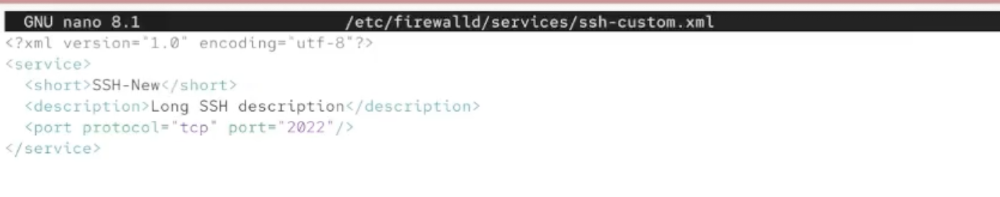
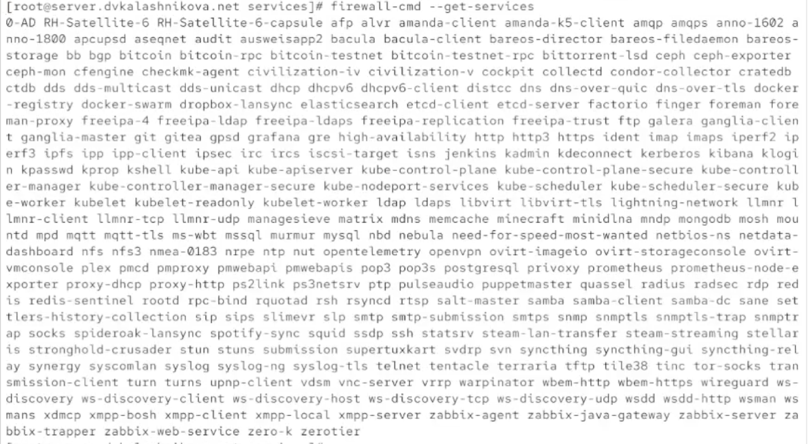
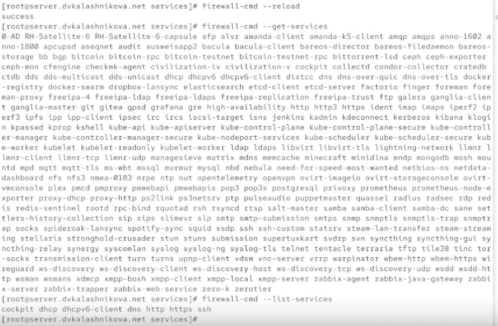
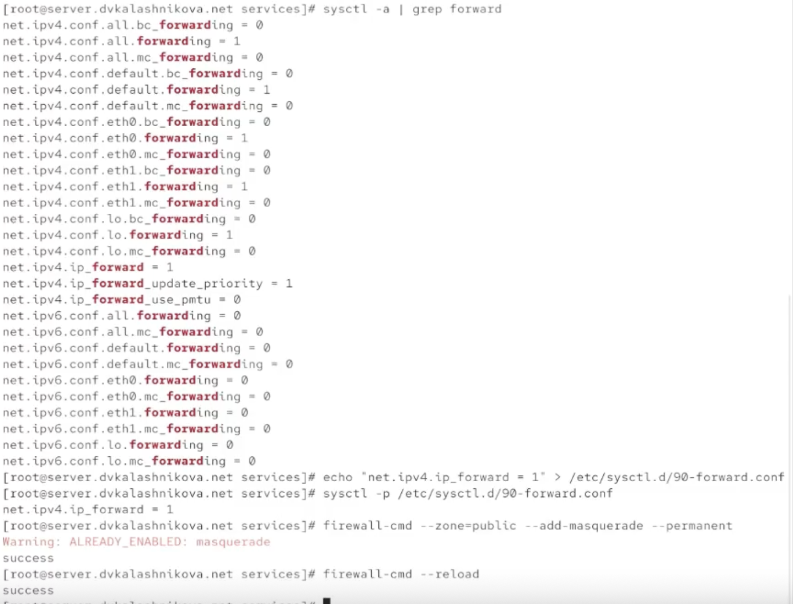
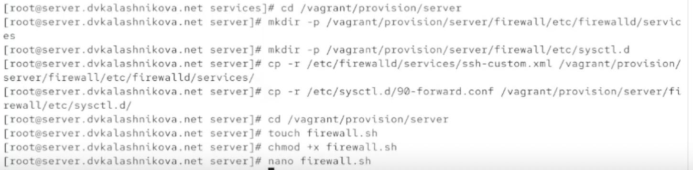
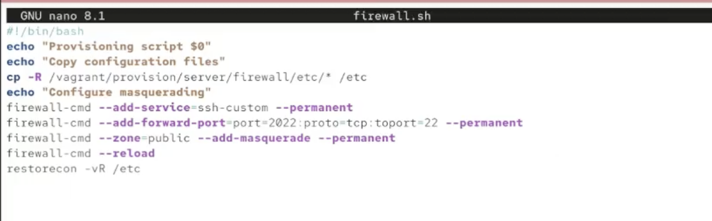

# Информация

## Докладчик

:::::::::::::: {.columns align=center}
::: {.column width="70%"}

  * Калашникова Дарья Викторовна
  * Студент
  * Российский университет дружбы народов
  * [1132243108@pfur.ru](mailto:1132243108@pfur.ru)

:::
::: {.column width="30%"}

:::
::::::::::::::

## Цель работы

Освоить настройку межсетевого экрана в Linux в части проброса портов и включения Masquerading

## Запуск сервера

Поднимаем сервер через vagrant

{#fig:001 width=60%}

## Копирование службы ssh

Заходим под суперпользователем и делаем копию файла описания службы ssh — назовём её ssh-custom.xml

{#fig:002 width=60%}

## Правка ssh-custom.xml

Дальше правим этот файл. Главное отличие — порт для tcp выставлен как 2022

{#fig:003 width=60%}

## Разбор XML-файла

Это XML-файл, описывающий пользовательскую службу для firewalld в Linux

- Строка 1: `<?xml version="1.0" encoding="utf-8"?>` — объявление XML
- Строка 2: `<service>` — открывающий тег, начало описания службы
- Строка 3: `<short>SSH-New</short>` — короткое имя службы
- Строка 4: `<description>Long SSH description</description>` — описание
- Строка 5: `<port protocol="tcp" port="2022"/>` — служба слушает TCP-порт 2022
- Строка 6: `</service>` — закрывающий тег, конец описания

## Список служб firewalld

Выводим список доступных служб — наша новая служба в нём пока не появилась

{#fig:004 width=60%}

## Перезапуск firewalld

Перезапускаем firewalld и снова смотрим список. Теперь служба есть в доступных, но в активных пока нет

{#fig:005 width=60%}

## Активация службы

Активируем ssh-custom, добавляем в постоянные и перезагружаем firewalld

{#fig:006 width=60%}

## Форвардинг портов

Через firewalld настраиваем переадресацию портов с 2022 на 22

{#fig:007 width=60%}

## Подключение по ssh

С клиента пробуем подключиться к серверу по ssh именно через порт 2022. Подключение успешно

{#fig:008 width=60%}

## Маскарадинг

Смотрим, включено ли в ядре перенаправление ipv4-пакетов. Переключатель в положении 0. Прописываем `net.ipv4.ip_forward = 1` в /etc/sysctl.d/90-forward.conf, загружаем конфиг и включаем маскарадинг

{#fig:009 width=30%}

## Проверка интернета

Проверяем с клиента выход в интернет — доступ есть

{#fig:010 width=60%}

## Сохранение конфигурации

Сохраняем все конфигурационные файлы в vagrant и создаём скрипт firewall.sh

{#fig:011 width=60%}

## firewall.sh

В скрипте firewall.sh прописываем строки для настройки ssh и маскарадинга

{#fig:012 width=60%}

## Vagrantfile

А в vagrantfile добавляем автозагрузку этого скрипта

{#fig:013 width=60%}

## Выводы

Получены навыки работы с фаерволом, а также настройки форвардинга и маскарадинга

## Список литературы

1. Red Hat. Configuring firewalls on Red Hat Enterprise Linux [Электронный ресурс]. — URL: https://docs.redhat.com/ (дата обращения: 13.10.2026)

2. firewalld Project. firewalld Documentation [Электронный ресурс]. — URL: https://firewalld.org/documentation/ (дата обращения: 13.10.2026)

3. The Linux Kernel Archives. IP Sysctl — ip_forward [Электронный ресурс]. — URL: https://www.kernel.org/doc/Documentation/networking/ip-sysctl.txt (дата обращения: 13.10.2026)
