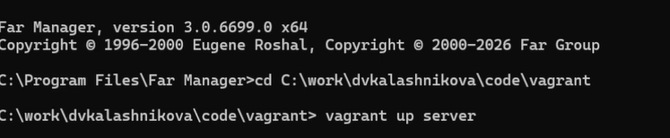
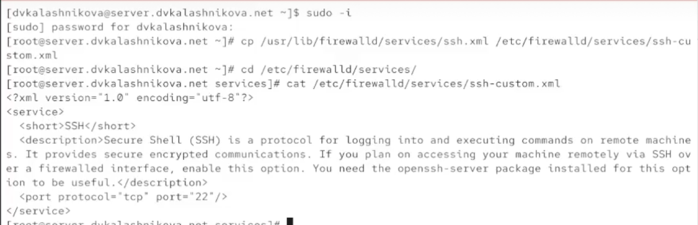
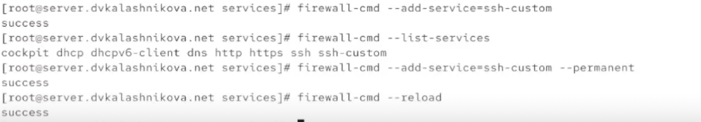
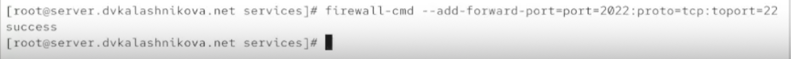
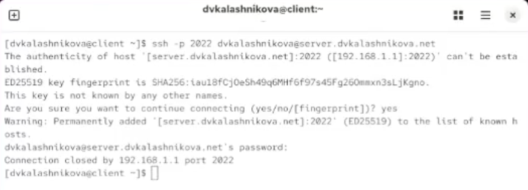
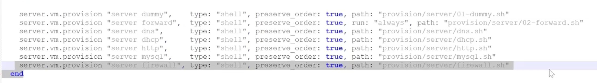

# Цель работы

Освоить настройку межсетевого экрана в Linux в части проброса портов и включения Masquerading.

# Выполнение лабораторной работы

Поднимаем сервер через vagrant (рис. [-@fig:001]).

{#fig:001}

Заходим под суперпользователем и делаем копию файла описания службы ssh — назовём её ssh-custom.xml (рис. [-@fig:002]).

{#fig:002}

Дальше правим этот файл. Главное отличие — порт для tcp выставлен как 2022.  
Это XML-файл, описывающий пользовательскую службу для брандмауэра firewalld в Linux. Разберём его построчно:

Строка 1: `<?xml version="1.0" encoding="utf-8"?>`  
Обычное объявление XML: версия 1.0 и кодировка UTF-8.

Строка 2: `<service>`  
Открывающий тег корневого элемента — начало описания новой службы для firewalld.

Строка 3: `<short>SSH-New</short>`  
Короткое имя службы, удобное для чтения. Здесь это «SSH-New».

Строка 4: `<description>Long SSH description</description>`  
Развёрнутое описание службы. В примере текст «Long SSH description» (Длинное описание SSH).

Строка 5: `<port protocol="tcp" port="2022"/>`  
Ключевая строка: служба работает по протоколу tcp и слушает порт 2022. При активации службы в firewalld брандмауэр откроет 2022 порт для входящих TCP-соединений.

Строка 6: `</service>`  
Закрывающий тег — конец описания службы (рис. [-@fig:003]).

{#fig:003}

Выводим список доступных служб firewalld. Наша новая служба в нём пока не появилась (рис. [-@fig:004]).

{#fig:004}

Перезапускаем firewalld и снова смотрим список доступных служб. Теперь наша служба в нём есть. Затем выводим список активных служб и видим, что наша служба пока не активна (рис. [-@fig:005]).

{#fig:005}

Активируем созданную службу ssh-custom. Проверяем, что она запущена и присутствует в списке активных, после чего добавляем её в постоянные и перезагружаем firewalld (рис. [-@fig:006]).

{#fig:006}

Через firewalld настраиваем переадресацию портов с 2022 на 22 (рис. [-@fig:007]).

{#fig:007}

С клиента пробуем подключиться к серверу по ssh именно через порт 2022. Подключение проходит успешно (рис. [-@fig:008]).

{#fig:008}

Смотрим, включено ли в ядре перенаправление ipv4-пакетов. Переключатель пока в положении 0. Прописываем `net.ipv4.ip_forward = 1` в /etc/sysctl.d/90-forward.conf, загружаем этот конфиг и через firewall-cmd включаем маскарадинг (рис. [-@fig:009]).

{#fig:009}

Проверяем с клиента выход в интернет — доступ есть (рис. [-@fig:010]).

{#fig:010}

Затем сохраняем все конфигурационные файлы в vagrant и создаём скрипт firewall.sh (рис. [-@fig:011]).

{#fig:011}

В скрипте firewall.sh прописываем строки для настройки ssh и маскарадинга (рис. [-@fig:012]).

{#fig:012}

А в vagrantfile добавляем автозагрузку этого скрипта (рис. [-@fig:013]).

{#fig:013}

# Выводы

В ходе лабораторной работы получены навыки работы с фаерволом, а также настройки форвардинга и маскарадинга.

# Список литературы {.unnumbered}

1. Red Hat. Configuring firewalls on Red Hat Enterprise Linux [Электронный ресурс]. — URL: https://docs.redhat.com/ (дата обращения: 07.10.2026).

2. firewalld Project. firewalld Documentation [Электронный ресурс]. — URL: https://firewalld.org/documentation/ (дата обращения: 07.10.2026).

3. The Linux Kernel Archives. IP Sysctl — ip_forward [Электронный ресурс]. — URL: https://www.kernel.org/doc/Documentation/networking/ip-sysctl.txt (дата обращения: 07.10.2026).
