# Информация

## Докладчик

:::::::::::::: {.columns align=center}
::: {.column width="70%"}

  * Калашникова Дарья Викторовна
  * Студент
  * Российский университет дружбы народов
  * [1132243108@pfur.ru](mailto:1132243108@pfur.ru)

:::
::: {.column width="30%"}

:::
::::::::::::::

## Цель работы

Получить практические навыки установки и настройки SMTP-сервера

## Установка Postfix

Сначала заходим на сервер под root и ставим postfix

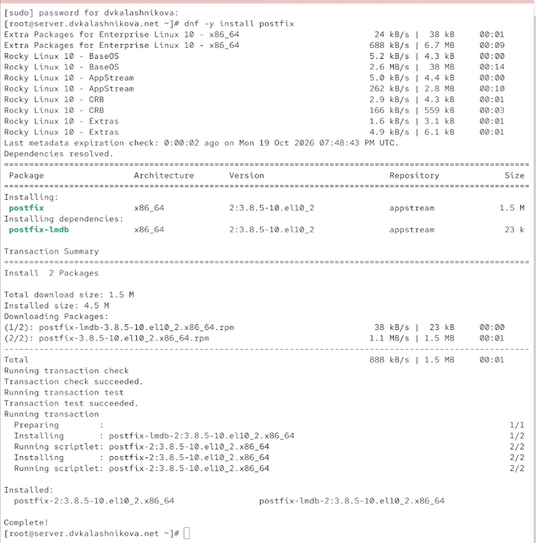{#fig-001 width=60%}

## Установка s-nail

Следом устанавливаем утилиту s-nail

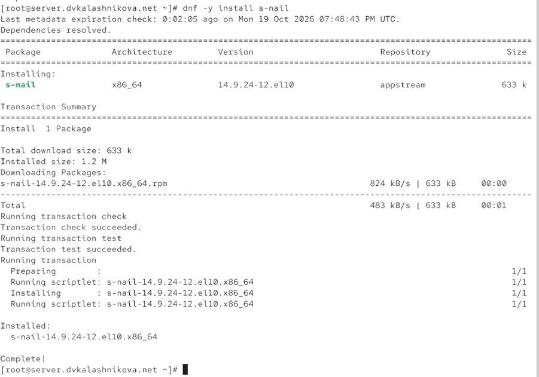{#fig-002 width=60%}

## Предварительная настройка

Открываем в фаерволе доступ к smtp, восстанавливаем контексты selinux и запускаем postfix

{#fig-003 width=60%}

## postconf

Выполняем postconf — команда выводит полный список параметров конфигурации

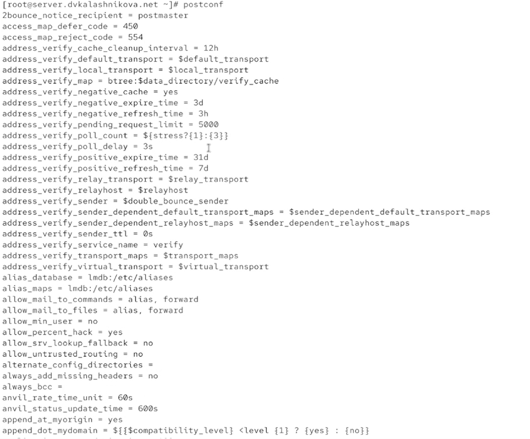{#fig-004 width=60%}

## Обновление конфигурации postfix

Смотрим значения myorigin и mydomain. Меняем myorigin на доменное имя, проверяем через postfix check и перезапускаем службу

{#fig-005 width=60%}

## postconf -n

Командой postconf -n выводим только те настройки, которые отличаются от значений по умолчанию

{#fig-006 width=60%}

## Настройка протоколов

Жёстко фиксируем имя домена. Оставляем только ipv4 и перезапускаем postfix

{#fig-007 width=60%}

## Отправка письма

Пробуем отправить письмо самому себе со своей учётной записи

{#fig-008 width=60%}

## Лог почты

В логе из /var/log/maillog видим «delivered to mailbox» — письмо доставлено

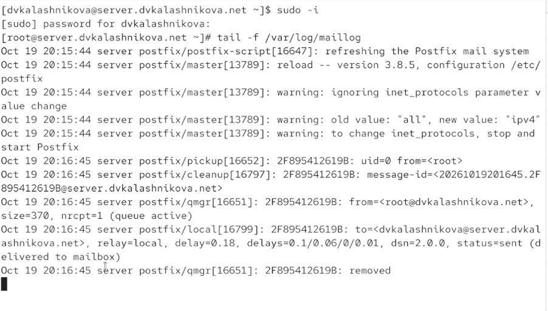{#fig-009 width=60%}

## /var/spool/mail

Проверяем, что в /var/spool/mail появились файлы пользователей

{#fig-010 width=60%}

## Установка на клиенте

Переходим на клиентскую машину, заходим под root и тоже ставим postfix

{#fig-011 width=60%}

## Установка s-nail на клиенте

Ставим и s-nail

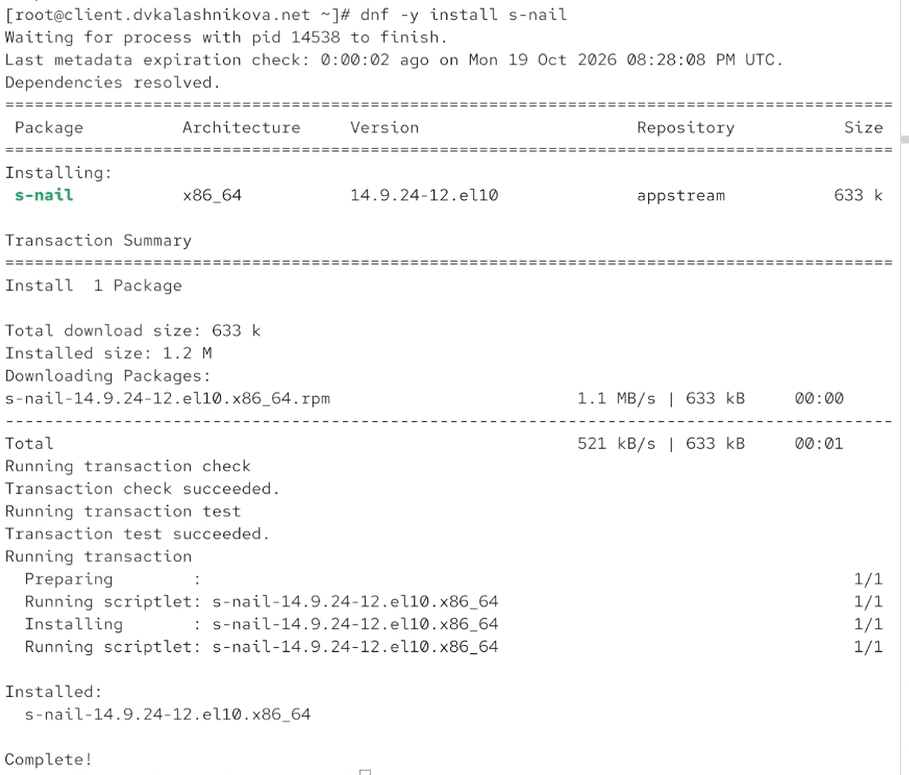{#fig-012 width=60%}

## Настройка протоколов на клиенте

Повторяем действия с сервера: оставляем только ipv4 и перезапускаем postfix

{#fig-013 width=60%}

## Отправка с клиента

Отправляем с клиента письмо на сервер

{#fig-014 width=60%}

## Логи на сервере

На сервере в логах ничего нового не появляется

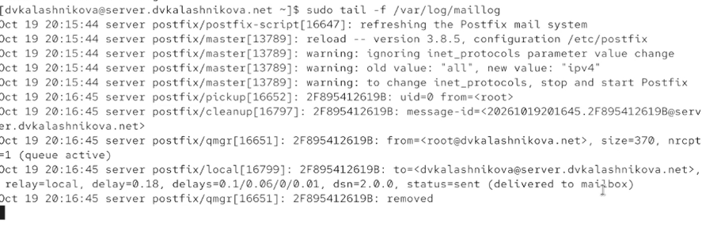{#fig-015 width=60%}

## Разрешение писем из локальной сети

Меняем inet_interfaces с localhost на all, добавляем в mynetworks 192.168.0.0 и перезапускаем postfix

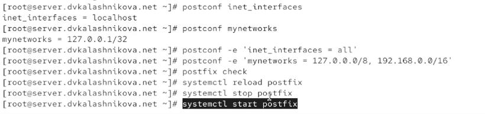{#fig-016 width=60%}

## Повторная отправка

Снова пробуем отправить письмо с клиента

{#fig-017 width=60%}

## Успешная доставка

В логах новое письмо EBE862044889, в предпоследней строке — delivered to mailbox

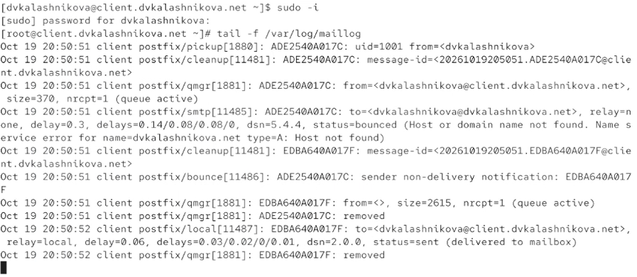{#fig-018 width=60%}

## Письмо пользователю

Пробуем отправить письмо не на устройство, а пользователю

{#fig-019 width=60%}

## Неуспешная доставка

Письмо 7482D204488 не доставляется — No route to host

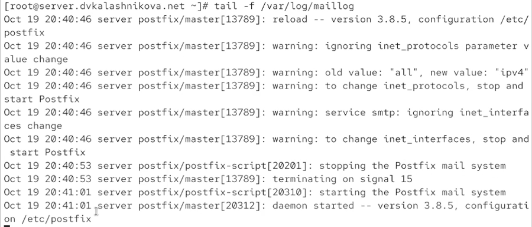{#fig-020 width=60%}

## postqueue -p

Информацию о зависшем письме смотрим командой postqueue -p

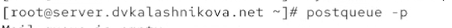{#fig-021 width=60%}

## Файл прямой зоны

Правим файл прямой зоны — добавляем запись о почтовом сервере

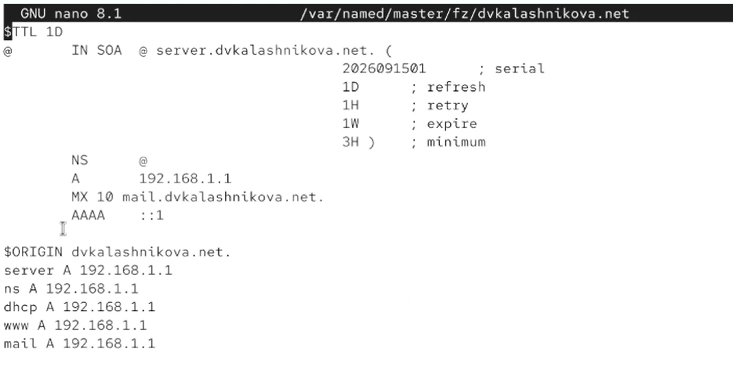{#fig-022 width=60%}

## Файл обратной зоны

Соответствующие изменения в обратной зоне

{#fig-023 width=60%}

## Обновление списков назначения

Обновляем список, перезапускаем postfix, selinux и dns, затем postqueue -f

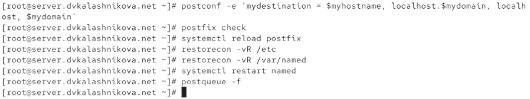{#fig-024 width=60%}

## Письмо доставлено

В логах видно, что письмо доставлено

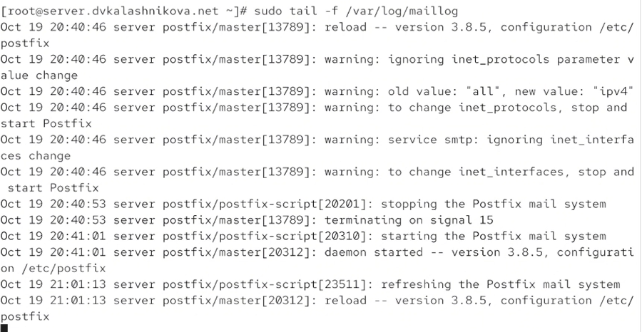{#fig-025 width=60%}

## Сохранение конфигурации

Сохраняем конфигурацию для vagrant с сервера и создаём mail.sh

{#fig-026 width=60%}

## mail.sh

В mail.sh записываем скрипт

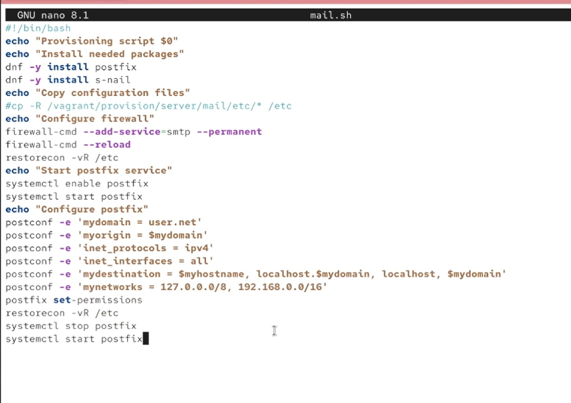{#fig-027 width=60%}

## mail.sh для клиента

Переключаемся на клиент и тоже создаём mail.sh

{#fig-028 width=60%}

## Скрипт для клиента

Скрипт для клиента выглядит так

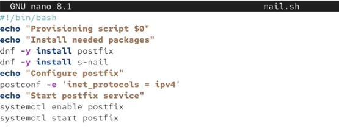{#fig-029 width=60%}

## Vagrantfile

В vagrantfile добавляем запуск скриптов для клиента и сервера

{#fig-030 width=60%}

## Выводы

В ходе лабораторной работы получены навыки настройки SMTP-сервера

## Список литературы

1. Postfix Project. Postfix Documentation [Электронный ресурс]. — URL: https://www.postfix.org/documentation.html (дата обращения: 13.10.2026)

2. Red Hat. Configuring email servers on Red Hat Enterprise Linux [Электронный ресурс]. — URL: https://docs.redhat.com/ (дата обращения: 13.10.2026)

3. IETF. RFC 5321: Simple Mail Transfer Protocol [Электронный ресурс]. — URL: https://datatracker.ietf.org/doc/html/rfc5321 (дата обращения: 13.10.2026)
