# Цель работы

Получить практические навыки установки и настройки SMTP-сервера.

# Выполнение лабораторной работы

Сначала заходим на сервер под root и ставим postfix (рис. [-@fig:001]).

{#fig:001}

Следом устанавливаем утилиту s-nail (рис. [-@fig:002]).

{#fig:002}

Затем открываем в фаерволе доступ к smtp, восстанавливаем контексты selinux и запускаем postfix (рис. [-@fig:003]).

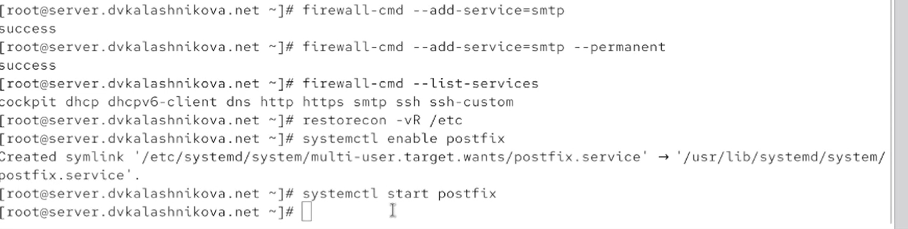{#fig:003}

Выполняем postconf — команда выводит полный список параметров конфигурации. Вывод получается довольно объёмным (рис. [-@fig:004]).

{#fig:004}

Смотрим значения myorigin и mydomain. mydomain — это имя домена, а myorigin — имя хоста. Меняем myorigin на доменное имя, проверяем корректность конфигурации через postfix check и перезапускаем службу (рис. [-@fig:005]).

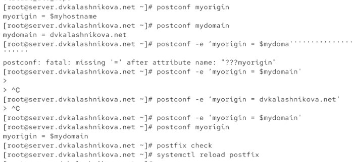{#fig:005}

Командой postconf -n выводим только те настройки, которые отличаются от значений по умолчанию (рис. [-@fig:006]).

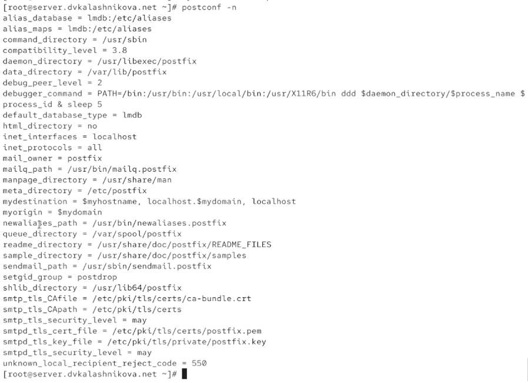{#fig:006}

Жёстко фиксируем имя домена как наш домен. После этого смотрим, какие интернет-протоколы разрешены. Сейчас разрешены все — оставляем только ipv4 и перезапускаем postfix (рис. [-@fig:007]).

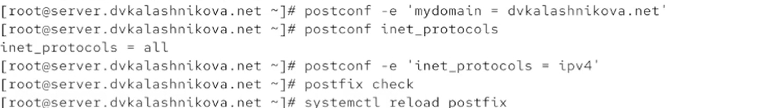{#fig:007}

Пробуем отправить письмо самому себе со своей учётной записи (рис. [-@fig:008]).

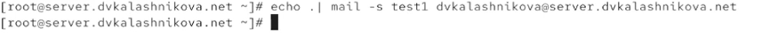{#fig:008}

Открываем в отдельной вкладке лог из /var/log/maillog. Видим, что письмо доставлено — об этом говорит строка «delivered to mailbox» перед последней записью (рис. [-@fig:009]).

{#fig:009}

Также проверяем, что в /var/spool/mail появились файлы пользователей (рис. [-@fig:010]).

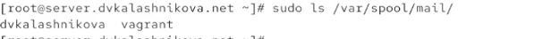{#fig:010}

Переходим на клиентскую машину, заходим под root и тоже устанавливаем postfix (рис. [-@fig:011]).

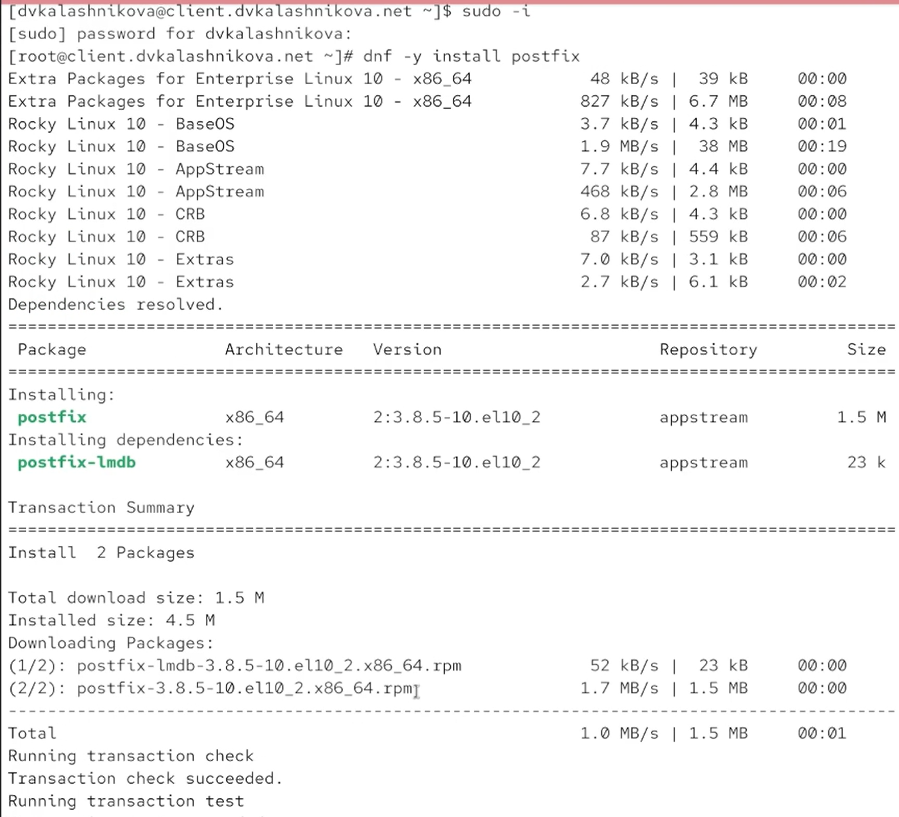{#fig:011}

Ставим и s-nail (рис. [-@fig:012]).

{#fig:012}

На клиенте повторяем действия с сервера: оставляем только ipv4 и перезапускаем postfix (рис. [-@fig:013]).

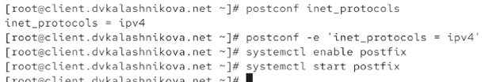{#fig:013}

Отправляем с клиента письмо на сервер (рис. [-@fig:014]).

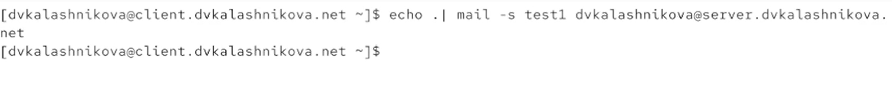{#fig:014}

На сервере в логах ничего нового не появляется (рис. [-@fig:015]).

{#fig:015}

Разрешаем другим устройствам в сети отправлять почту на сервер. Для этого меняем inet_interfaces с localhost на all и добавляем в mynetworks нашу локальную сеть 192.168.0.0, после чего перезапускаем postfix (рис. [-@fig:016]).

{#fig:016}

Снова пробуем отправить письмо с клиента (рис. [-@fig:017]).

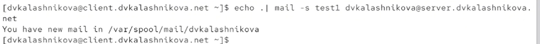{#fig:017}

Теперь в логах видно новое письмо. Указано «delivered to mailbox» — доставка успешна (рис. [-@fig:018]).

{#fig:018}

Пробуем отправить письмо не на устройство, а пользователю (рис. [-@fig:019]).

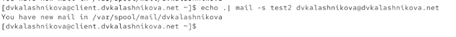{#fig:019}

Письмо не доставляется — нет информации о почтовом сервере (No route to host) (рис. [-@fig:020]).

{#fig:020}

Информацию о зависшем письме смотрим командой postqueue -p (рис. [-@fig:021]).

{#fig:021}

Теперь правим файлы прямой и обратной зоны, чтобы добавить данные о почтовом сервере. В файле прямой зоны появляется запись о почтовом сервере (рис. [-@fig:022]).

{#fig:022}

В файле обратной зоны — соответствующие изменения (рис. [-@fig:023]).

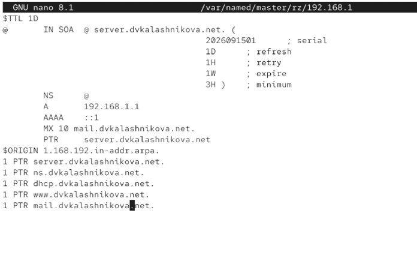{#fig:023}

Обновляем список пунктов назначения, добавив туда сервер, перезапускаем postfix, обновляем метки selinux и перезапускаем dns-сервер. Затем командой postqueue -f выгружаем очередь сообщений (рис. [-@fig:024]).

{#fig:024}

Теперь в логах видно, что письмо доставлено (рис. [-@fig:025]).

{#fig:025}

Сохраняем конфигурацию для vagrant с сервера и создаём файл mail.sh (рис. [-@fig:026]).

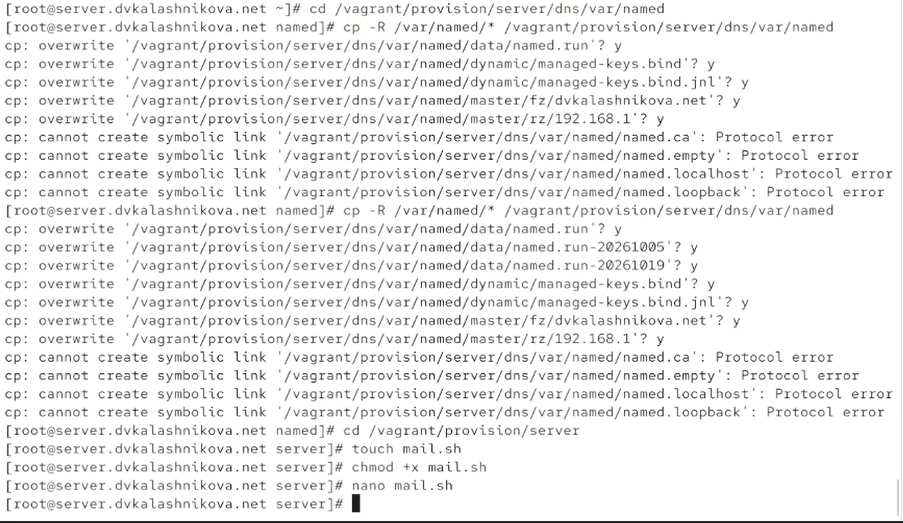{#fig:026}

В mail.sh записываем скрипт (рис. [-@fig:027]).

{#fig:027}

Переключаемся на клиент и тоже создаём для него mail.sh (рис. [-@fig:028]).

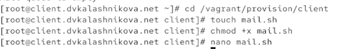{#fig:028}

Скрипт для клиента выглядит так (рис. [-@fig:029]).

{#fig:029}

В vagrantfile добавляем запуск этих скриптов для клиента и сервера (рис. [-@fig:030]).

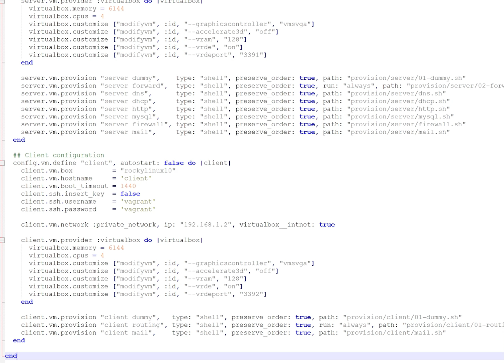{#fig:030}

# Выводы

В ходе лабораторной работы получены навыки настройки SMTP-сервера.

# Список литературы {.unnumbered}

1. Postfix Project. Postfix Documentation [Электронный ресурс]. — URL: https://www.postfix.org/documentation.html (дата обращения: 13.10.2026).

2. Red Hat. Configuring email servers on Red Hat Enterprise Linux [Электронный ресурс]. — URL: https://docs.redhat.com/ (дата обращения: 13.10.2026).

3. IETF. RFC 5321: Simple Mail Transfer Protocol [Электронный ресурс]. — URL: https://datatracker.ietf.org/doc/html/rfc5321 (дата обращения: 13.10.2026).
