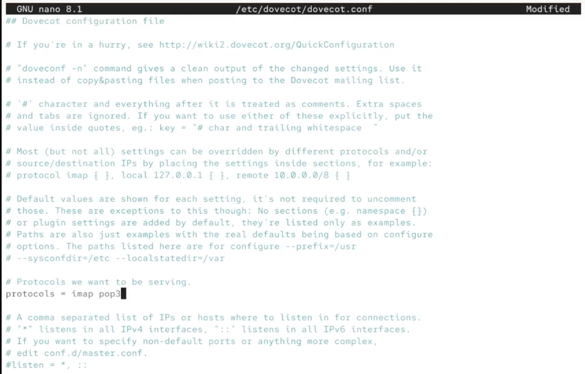
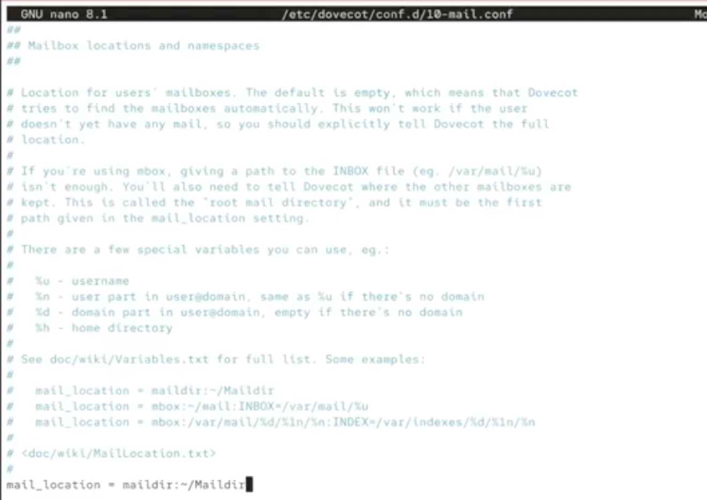
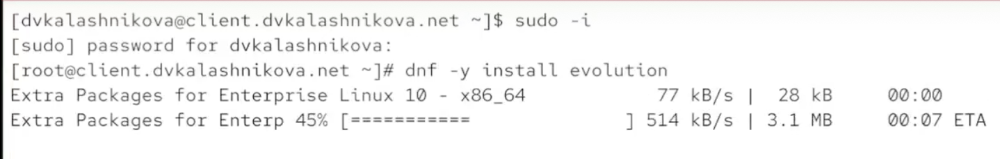
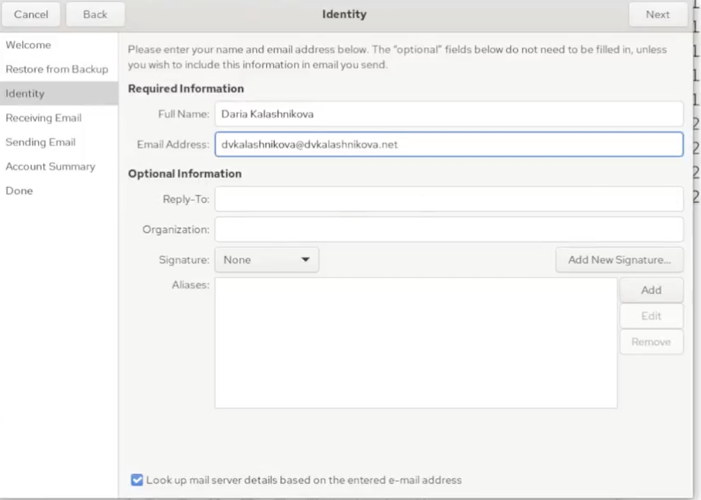
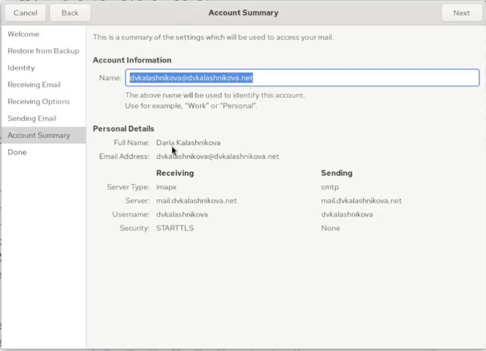
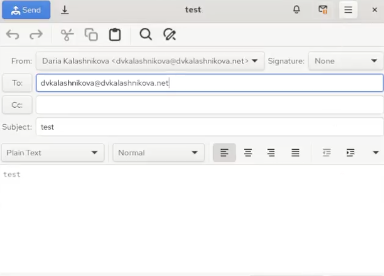
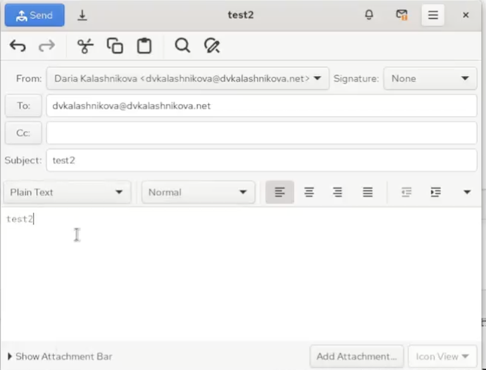
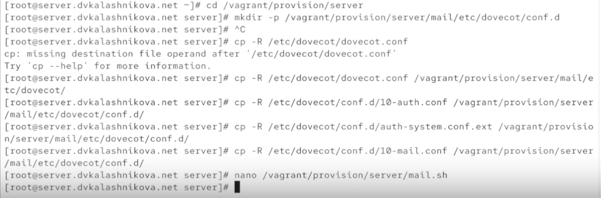
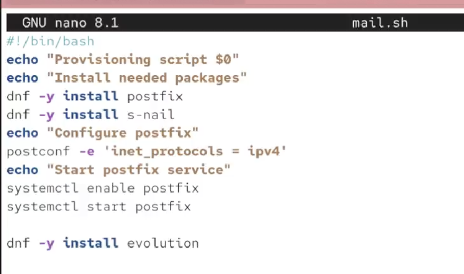

# Информация

## Докладчик

:::::::::::::: {.columns align=center}
::: {.column width="70%"}

  * Калашникова Дарья Викторовна
  * Студент
  * Российский университет дружбы народов
  * [1132243108@pfur.ru](mailto:1132243108@pfur.ru)

:::
::: {.column width="30%"}

:::
::::::::::::::

## Цель работы

Получить практические навыки установки и первичной настройки почтового сервера POP3/IMAP

## Установка пакетов

Заходим на сервер и ставим dovecot и telnet

{#fig:001 width=60%}

## Настройка dovecot.conf

Прописываем в параметр protocols протоколы imap и pop3

{#fig:002 width=60%}

## 10-auth.conf

Проверяем, что auth_mechanisms установлен в plain

{#fig:003 width=60%}

## auth-system.conf.ext (passwd)

Параметр driver для passwd должен быть равен pam

{#fig:004 width=60%}

## auth-system.conf.ext (userdb)

Параметр driver для userdb должен быть равен passwd

{#fig:005 width=60%}

## 10-mail.conf

Задаём нужный параметр для mail_location

{#fig:006 width=60%}

## Настройка postfix

Устанавливаем home_mailbox равным Maildir

{#fig:007 width=60%}

## Настройка firewall

Разрешаем работу протоколов pop3 и imap

{#fig:008 width=40%}

## Запуск служб

Восстанавливаем метки SELinux, перезапускаем postfix и включаем dovecot

{#fig:009 width=60%}

## Мониторинг логов

В отдельном терминале следим за логом из /var/log/maillog в реальном времени

{#fig:010 width=60%}

## mail и doveadm (сервер)

Ящик INBOX присутствует, но папки с почтой нет, пока не пришло ни одного письма

{#fig:011 width=60%}

## Установка клиента

На машине client ставим почтовый клиент evolution

{#fig:012 width=60%}

## Вкладка identity

Вводим свои данные для учётной записи

{#fig:013 width=60%}

## Вкладка receiving email

Настраиваем входящую почту: imap, порт 143, аутентификация по паролю, шифрование STARTTLS after connecting

{#fig:014 width=40%}

## Вкладка sending email

Настраиваем исходящую почту: pop3, порт 25, без шифрования и авторизации

{#fig:015 width=60%}

## account summary

Проверяем, что все настройки указаны верно

{#fig:016 width=60%}

## Первое письмо

Пишем себе письмо с темой test и телом test

{#fig:017 width=60%}

## Второе письмо

Отправляем второе письмо с темой test2 и без тела

{#fig:018 width=40%}

## Проверка отправки

Письма появились в ящике inbox — доставка успешна

{#fig:019 width=60%}

## Логи сервера

Сервер обработал два письма с ID 896BE2044481 и EFFC82044481; в логах — delivered to maildir

{#fig:020 width=60%}

## Повторная проверка mail и doveadm

mail показывает два письма с теми же темами, doveadm сообщает о наличии ящика inbox

{#fig:021 width=60%}

## Работа через telnet

Подключаемся к серверу, логинимся. list выводит список писем, retr читает первое письмо, dele удаляет второе, quit — выход

{#fig:022 width=40%}

## Сохранение конфигурации

Сохраняем конфиги в vagrant и модифицируем скрипт mail.sh

{#fig:023 width=60%}

## mail.sh на сервере

Добавляем строки установки пакетов, настройки фаервола, postfix и его перезапуск, а также запуск dovecot

{#fig:024 width=40%}

## mail.sh на клиенте

Добавляем строку об установке evolution

{#fig:025 width=60%}

## Выводы

Получены навыки настройки и использования простейшего imap/pop3 сервера

## Список литературы

1. Dovecot Project. Dovecot Documentation [Электронный ресурс]. — URL: https://doc.dovecot.org/ (дата обращения: 29.10.2026)

2. Postfix Project. Postfix Documentation [Электронный ресурс]. — URL: https://www.postfix.org/documentation.html (дата обращения: 29.10.2026)

3. IETF. RFC 3501: Internet Message Access Protocol (IMAP) [Электронный ресурс]. — URL: https://datatracker.ietf.org/doc/html/rfc3501 (дата обращения: 29.10.2026)
