# Цель работы

Получить практические навыки установки и первичной настройки почтового сервера POP3/IMAP.

# Выполнение лабораторной работы

Заходим на виртуальную машину server и ставим пакеты dovecot и telnet (рис. [-@fig:001]).

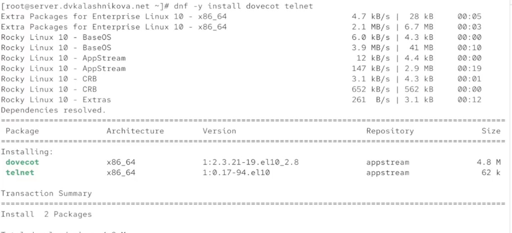{#fig:001}

Открываем конфигурационный файл /etc/dovecot/dovecot.conf и прописываем в параметр protocols два почтовых протокола, которые используются в этой работе — imap и pop3 (рис. [-@fig:002]).

{#fig:002}

Переходим в /etc/dovecot/conf.d/10-auth.conf и проверяем, что параметр auth_mechanisms установлен в значение plain (рис. [-@fig:003]).

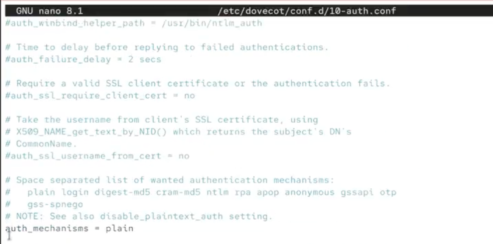{#fig:003}

Открываем /etc/dovecot/conf.d/auth-system.conf.ext и удостоверяемся, что параметр driver для passwd равен pam (рис. [-@fig:004]).

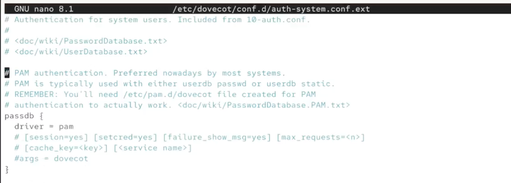{#fig:004}

В том же файле смотрим, что driver для userdb соответствует значению passwd (рис. [-@fig:005]).

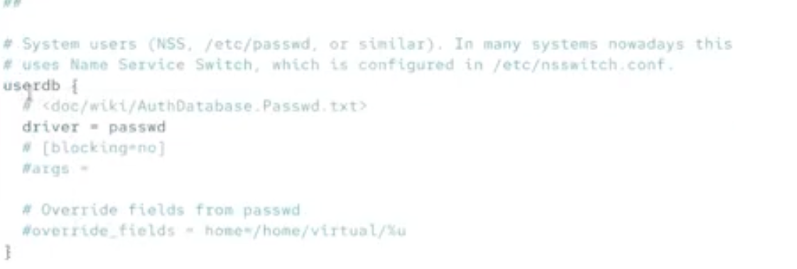{#fig:005}

Открываем /etc/dovecot/conf.d/10-mail.conf и задаём нужный параметр для mail_location (рис. [-@fig:006]).

{#fig:006}

Теперь настраиваем postfix. Устанавливаем home_mailbox равным Maildir (рис. [-@fig:007]).

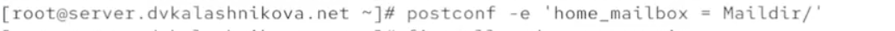{#fig:007}

Настраиваем firewall, разрешая работу протоколов pop3 и imap (рис. [-@fig:008]).

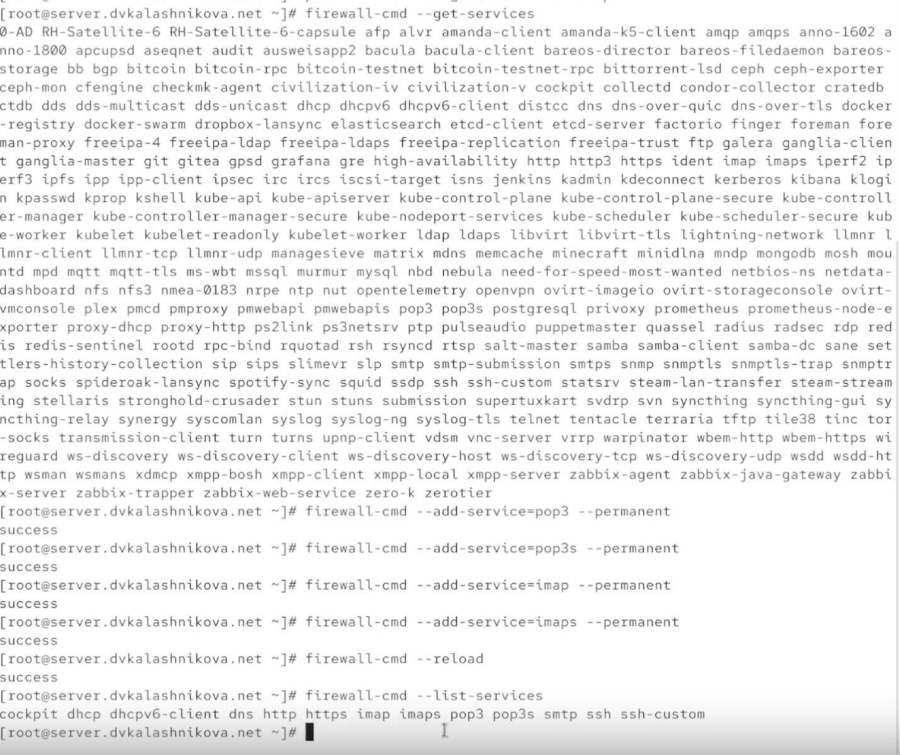{#fig:008}

Затем восстанавливаем метки SELinux, перезапускаем postfix и включаем dovecot (рис. [-@fig:009]).

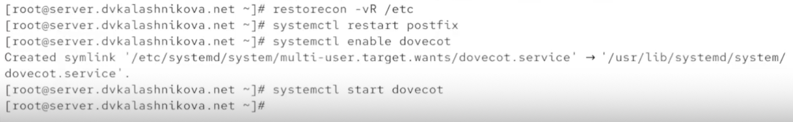{#fig:009}

В отдельном терминале начинаем в реальном времени следить за логом почтовой службы из файла /var/log/maillog (рис. [-@fig:010]).

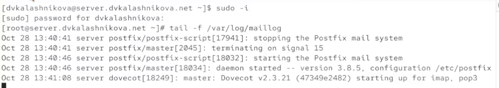{#fig:010}

Командами mail и doveadm смотрим информацию о почте и почтовом ящике. У пользователя присутствует ящик INBOX (это видно по doveadm). Вывод команды mail показывает, что папки с почтой для нашего пользователя нет — причина в том, что ему ещё не приходило ни одного письма, из-за чего папка не создалась (рис. [-@fig:011]).

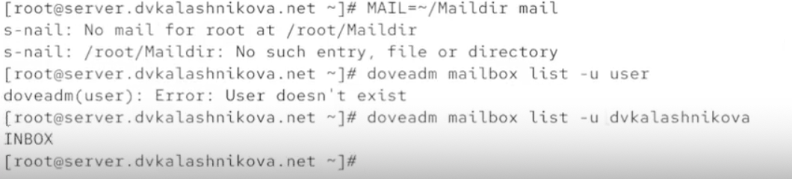{#fig:011}

Теперь включаем машину client. Устанавливаем на неё почтовый клиент evolution (рис. [-@fig:012]).

{#fig:012}

После запуска программы появляется окно с предложением настроить клиент. Во вкладке identity вводим свои данные (рис. [-@fig:013]).

{#fig:013}

Во вкладке receiving email настраиваем входящую почту. Отвечать за неё будет протокол imap на порту 143. Аутентификация — простая по паролю, шифрование — STARTTLS after connecting (рис. [-@fig:014]).

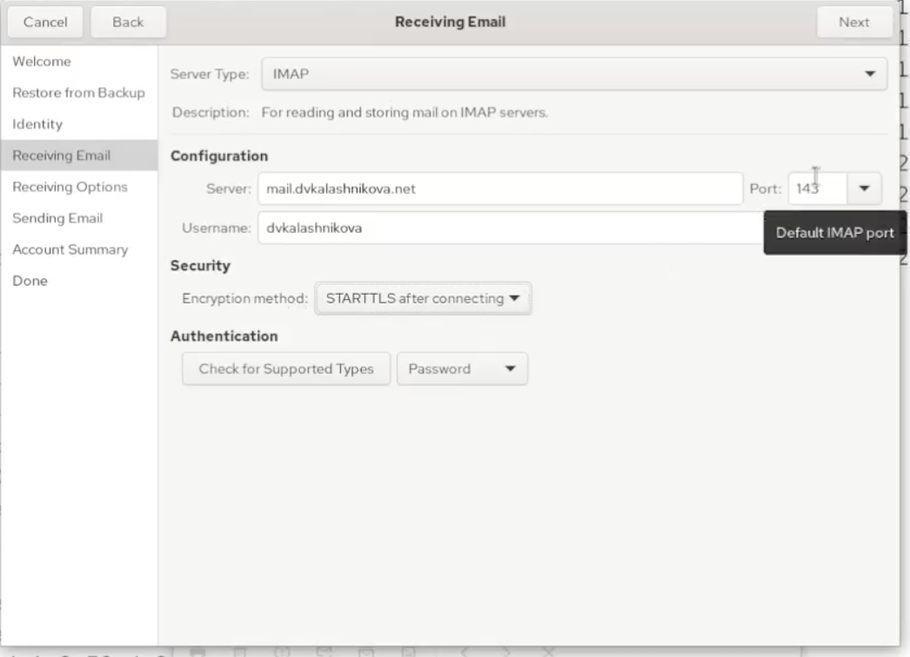{#fig:014}

Заполняем вкладку sending email. Это исходящая почта: за отправку отвечает протокол pop3 на порту 25, без шифрования и авторизации (рис. [-@fig:015]).

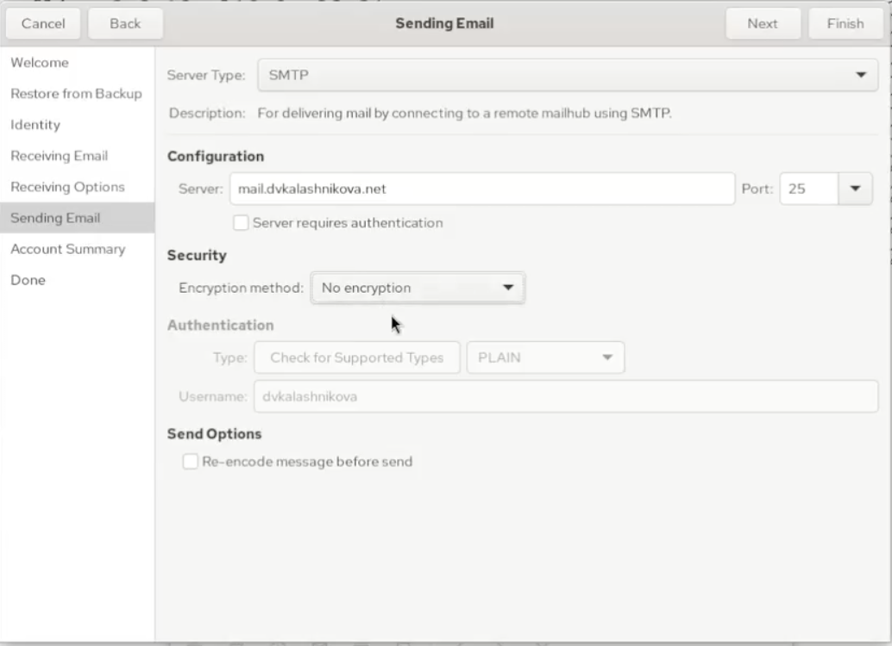{#fig:015}

В account summary убеждаемся, что всё настроено правильно (рис. [-@fig:016]).

{#fig:016}

Пишем себе первое письмо — с темой test и телом test (рис. [-@fig:017]).

{#fig:017}

Пишем второе письмо — с темой test2 и без тела (рис. [-@fig:018]).

{#fig:018}

Проверяем, что письма ушли и успешно доставлены. Об этом говорит их появление в ящике inbox — значит, доставка прошла удачно (рис. [-@fig:019]).

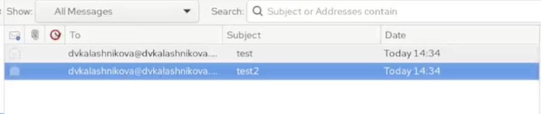{#fig:019}

Смотрим, что появилось в логах на сервере. Сервер успешно обработал два письма с разными идентификаторами — 896BE2044481 и EFFC82044481. Об успешной отправке свидетельствуют записи delivered to maildir (рис. [-@fig:020]).

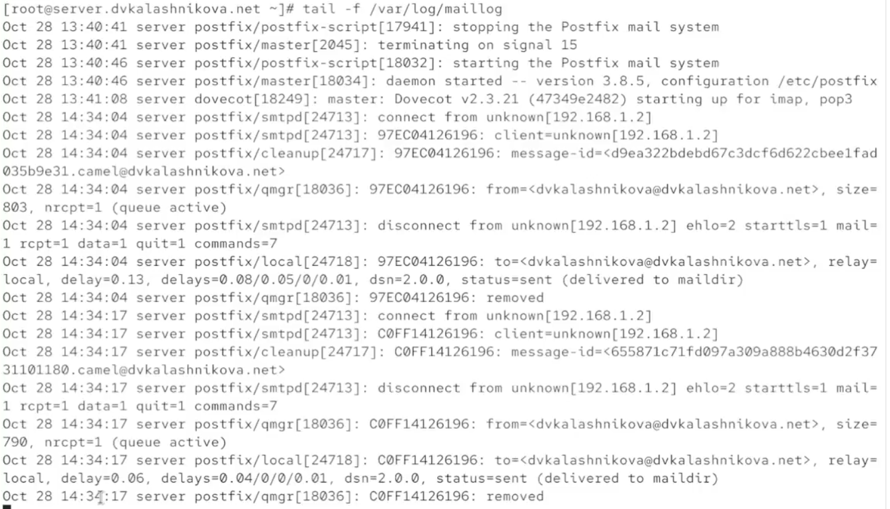{#fig:020}

Теперь смотрим вывод mail и doveadm. mail показывает два письма с теми темами, которые мы задавали, а doveadm сообщает о наличии почтового ящика inbox (рис. [-@fig:021]).

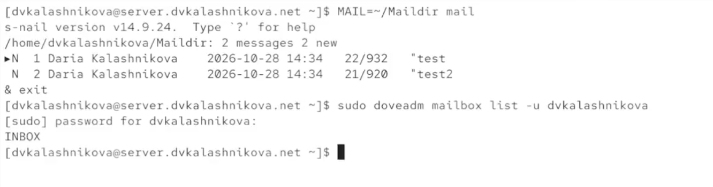{#fig:021}

Далее подключаемся к почтовому серверу через telnet. Логинимся под нашим пользователем. Команда list выводит список из двух элементов — наших писем. Командой retr читаем содержимое первого письма: там есть данные о том, куда отправить, кому доставлено, от кого получено, айди, тема, дата, тело и прочие характеристики. Командой dele удаляем второе сообщение и выходим через quit (рис. [-@fig:022]).

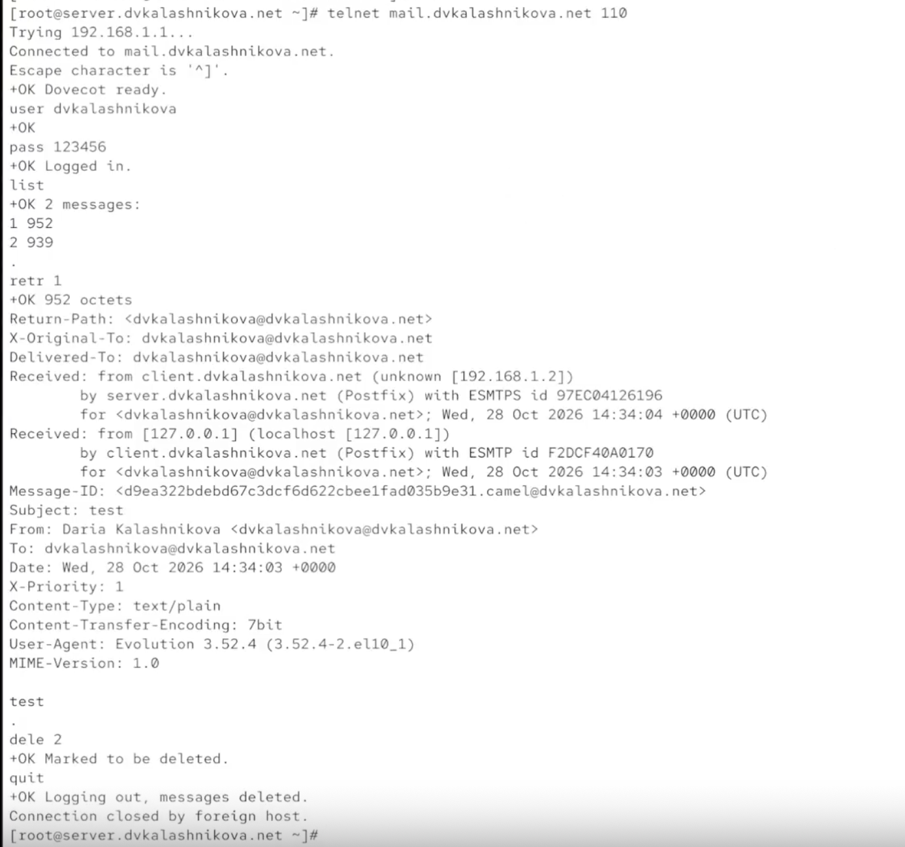{#fig:022}

Сохраняем все конфигурации в vagrant. Кроме того, модифицируем скрипт mail.sh (рис. [-@fig:023]).

{#fig:023}

В mail.sh добавляем строки, отвечающие за установку пакетов, настройку фаервола, настройку postfix и его перезапуск, а также запуск службы dovecot (рис. [-@fig:024]).

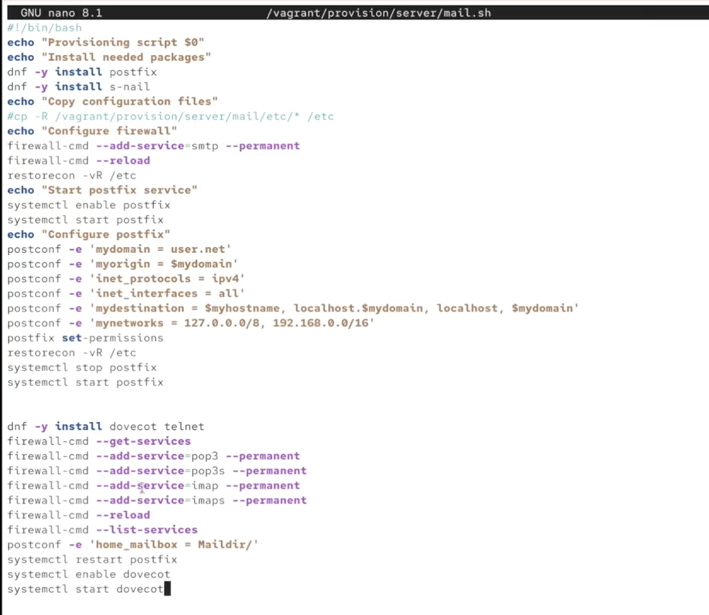{#fig:024}

На клиенте тоже редактируем mail.sh: добавляем строку об установке почтового клиента evolution (рис. [-@fig:025]).

{#fig:025}

# Выводы

В ходе лабораторной работы получены навыки настройки и использования простейшего imap/pop3 сервера.

# Список литературы {.unnumbered}

1. Dovecot Project. Dovecot Documentation [Электронный ресурс]. — URL: https://doc.dovecot.org/ (дата обращения: 13.10.2026).

2. Postfix Project. Postfix Documentation [Электронный ресурс]. — URL: https://www.postfix.org/documentation.html (дата обращения: 13.10.2026).

3. IETF. RFC 3501: Internet Message Access Protocol (IMAP) [Электронный ресурс]. — URL: https://datatracker.ietf.org/doc/html/rfc3501 (дата обращения: 13.10.2026).
