# Цель работы

Освоить настройку аутентификации при работе с SMTP-сервером на практике.

# Выполнение лабораторной работы

Во втором терминале сервера включаем потоковый вывод почтового лога (рис. [-@fig:001]).

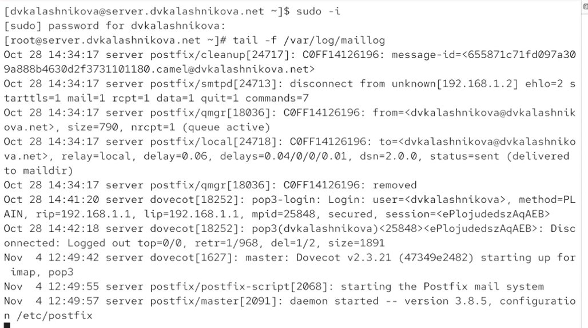{#fig:001}

В первом терминале сервера входим под рутом и открываем файл /etc/dovecot/dovecot.conf (рис. [-@fig:002]).

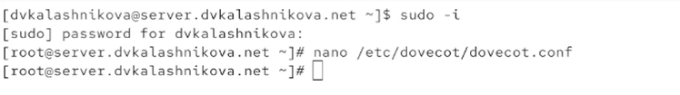{#fig:002}

В список активных протоколов добавляем lmtp (рис. [-@fig:003]).

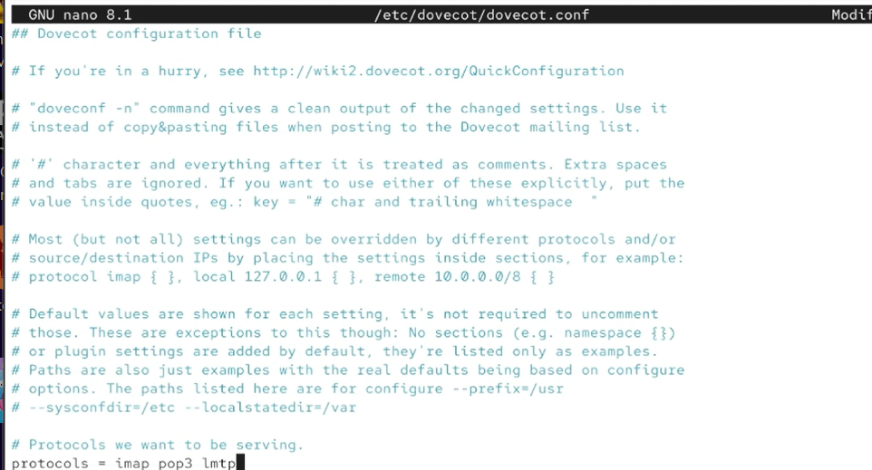{#fig:003}

Затем открываем файл /etc/dovecot/conf.d/10-master.conf (рис. [-@fig:004]).

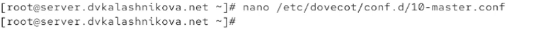{#fig:004}

Внутри него прописываем блок для службы lmtp (рис. [-@fig:005]).

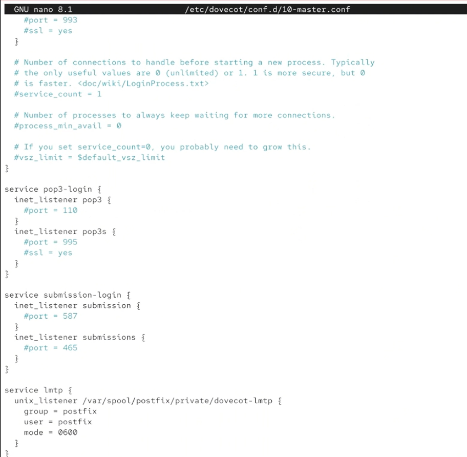{#fig:005}

Затем указываем в postfix сокет, через который будут отправляться сообщения. После этого открываем /etc/dovecot/conf.d/10-auth.conf (рис. [-@fig:006]).

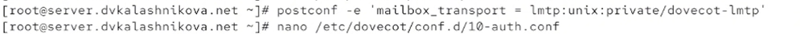{#fig:006}

В этом файле выставляем значение auth_username_format, которое задаёт формат имени пользователя при аутентификации. В нашем случае домен не указывается (рис. [-@fig:007]).

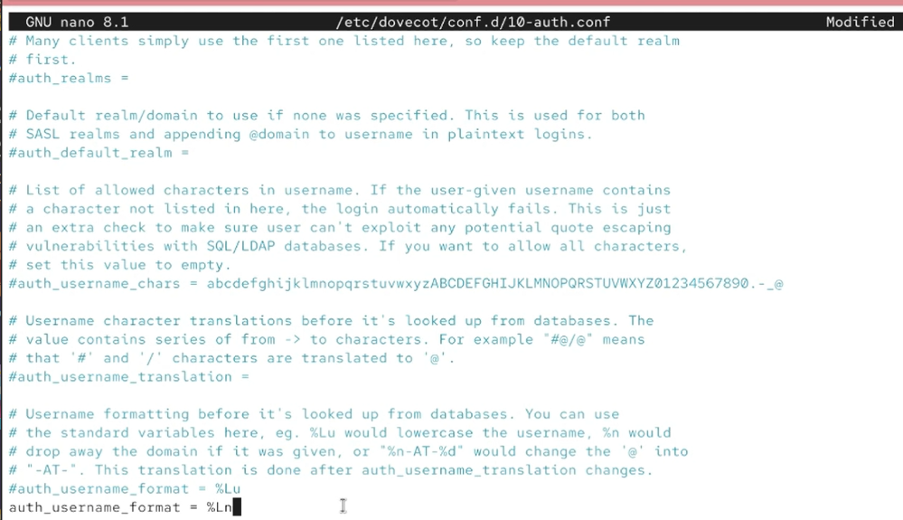{#fig:007}

Перезапускаем postfix и dovecot (рис. [-@fig:008]).

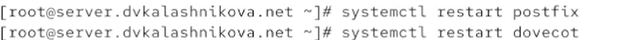{#fig:008}

Переходим на клиентскую машину и пробуем отправить письмо самому себе (рис. [-@fig:009]).

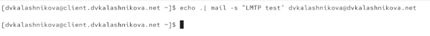{#fig:009}

В логах на сервере (которые мы открыли в начале) видим, что письмо попало в ящик — об этом говорит запись «saved mail to INBOX». Кроме того, в логах появилось указание, что доставка идёт через lmtp (passing ... to transport=lmtp) (рис. [-@fig:010]).

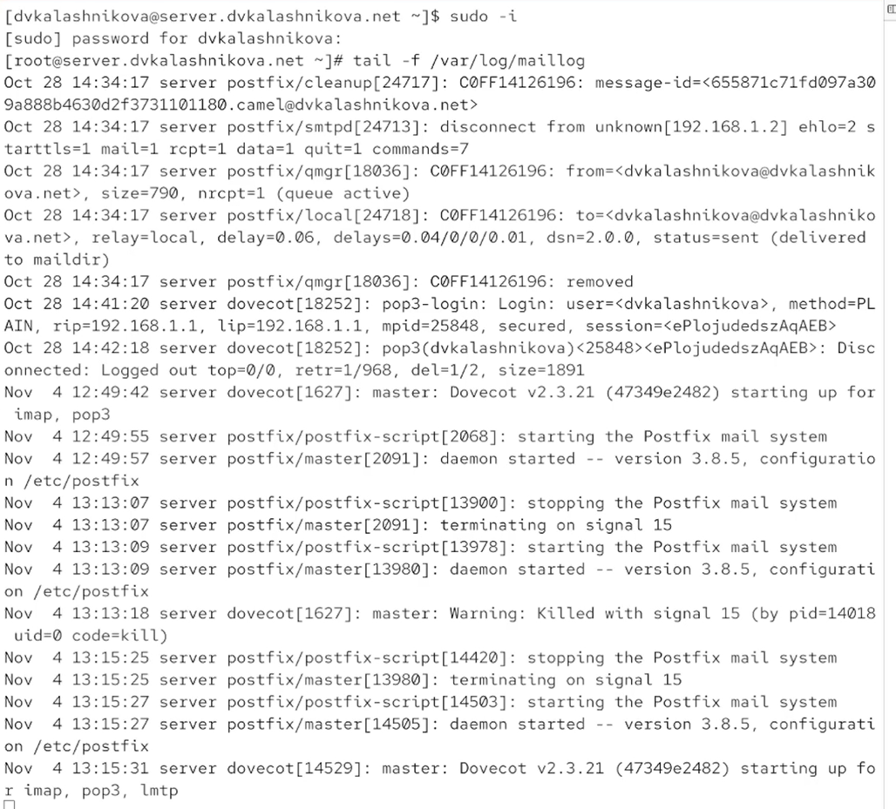{#fig:010}

Открываем на сервере почтовый ящик и убеждаемся, что письмо действительно на месте (рис. [-@fig:011]).

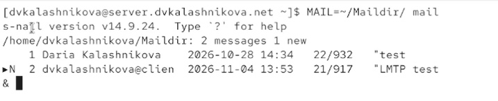{#fig:011}

Снова обращаемся к /etc/dovecot/conf.d/10-master.conf (рис. [-@fig:012]).

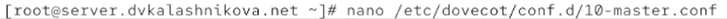{#fig:012}

Приводим блок службы auth к следующему виду. Разбираем по строкам:

`service auth { ... }` — начало секции конфигурации для внутренней службы Dovecot auth.

`unix_listener /var/spool/postfix/private/auth { ... }` — Dovecot создаёт слушатель на основе UNIX-сокета.

`group = postfix` — группа-владелец файла сокета.

`user = postfix` — пользователь-владелец файла сокета.

`mode = 0660` — права доступа к сокету в восьмеричном виде.

`unix_listener auth-userdb { ... }` — создание второго UNIX-сокета.

`mode = 0600` — права доступа для внутреннего сокета.

`user = dovecot` — пользователь-владелец dovecot (рис. [-@fig:013]).

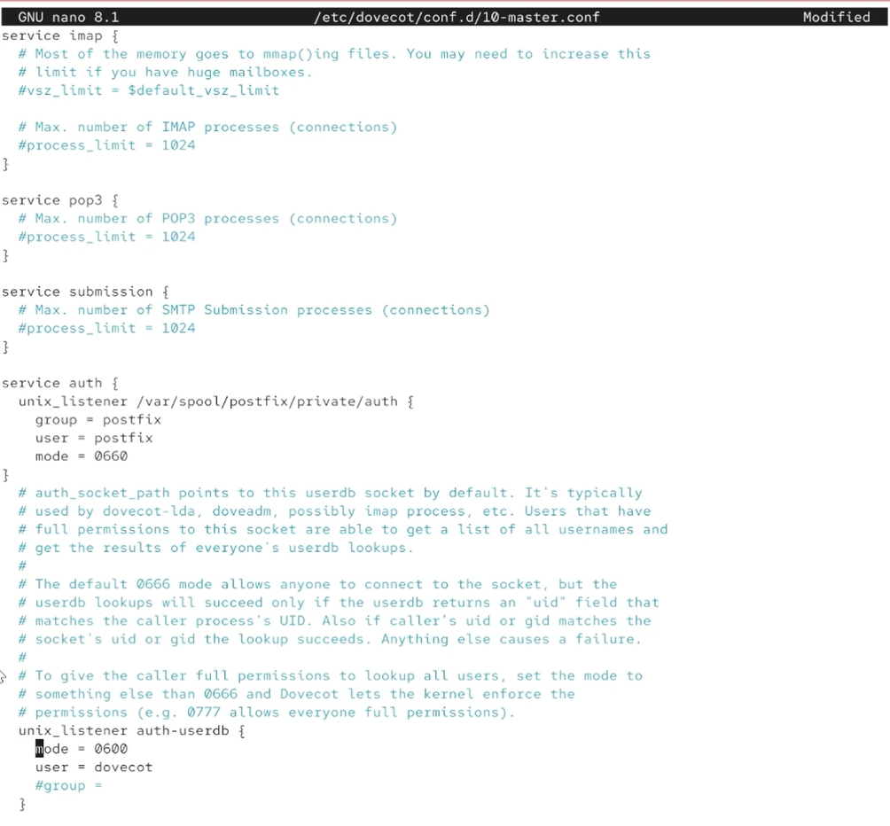{#fig:013}

Теперь настраиваем аутентификацию smtp в postfix и задаём правила обработки и фильтрации почты. Разбираем опции:

`reject_unknown_recipient_domain` — отклонить письмо, если домен получателя не существует.

`permit_mynetworks` — пропустить письмо без проверок, если IP клиента входит в список доверенных сетей.

`reject_non_fqdn_recipient` — отклонить, если адрес получателя не является полностью определённым доменным именем.

`reject_unauth_destination` — отклонить письмо, если домен получателя не локальный для этого сервера и сессия не аутентифицирована.

`reject_unverified_recipient` — отклонить, если Postfix не может проверить существование получателя.

`permit` — если предыдущие правила не отклонили и не разрешили письмо, оно пропускается (рис. [-@fig:014]).

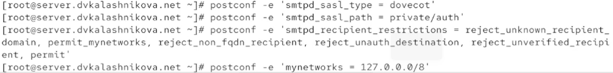{#fig:014}

Далее редактируем файл /etc/postfix/master.cf (рис. [-@fig:015]).

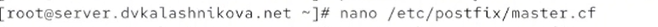{#fig:015}

Вносим изменения так, чтобы smtp поддерживал авторизацию по sasl (рис. [-@fig:016]).

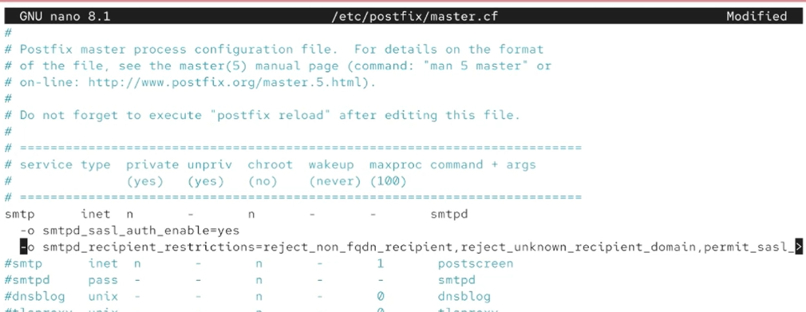{#fig:016}

Перезапускаем postfix и dovecot (рис. [-@fig:017]).

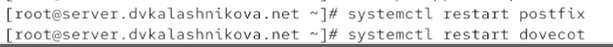{#fig:017}

На клиенте устанавливаем telnet (рис. [-@fig:018]).

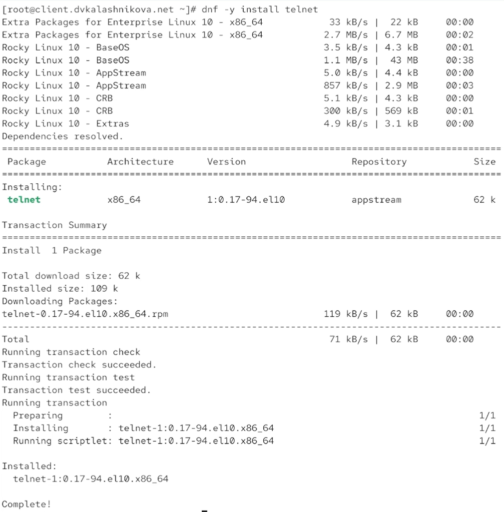{#fig:018}

Получаем ключ авторизации — строку с логином и паролем, зашифрованную в base64. Подключаемся к почтовому серверу по telnet, проверяем соединение. Затем командой auth пытаемся авторизоваться, используя этот ключ. Авторизация проходит успешно (Authentication successful) (рис. [-@fig:019]).

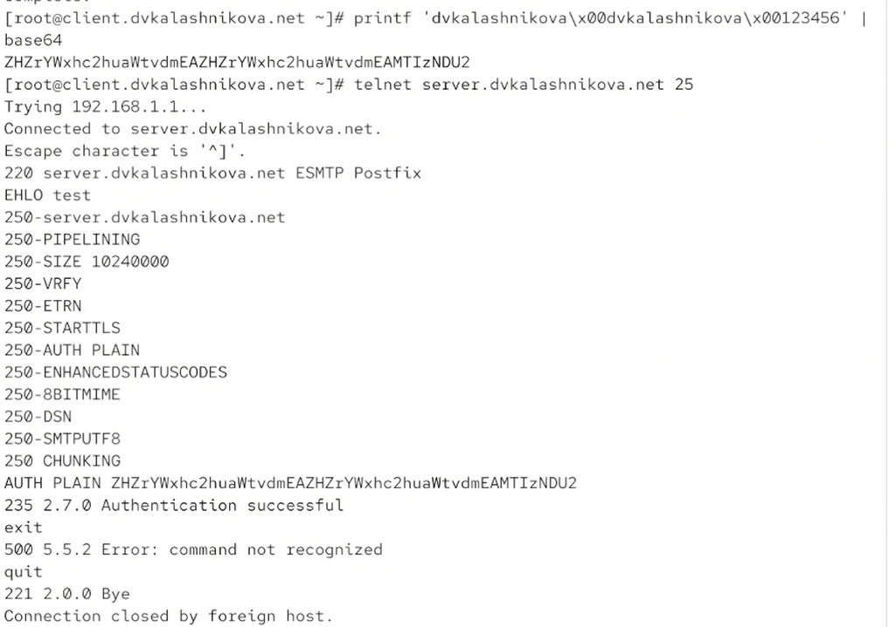{#fig:019}

Настраиваем сертификаты для postfix, а также уровень безопасности и путь к базе кэша (рис. [-@fig:020]).

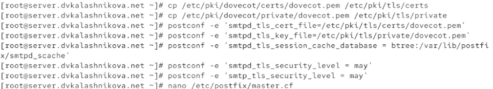{#fig:020}

Снова открываем /etc/postfix/master.cf и правим его следующим образом (рис. [-@fig:021]).

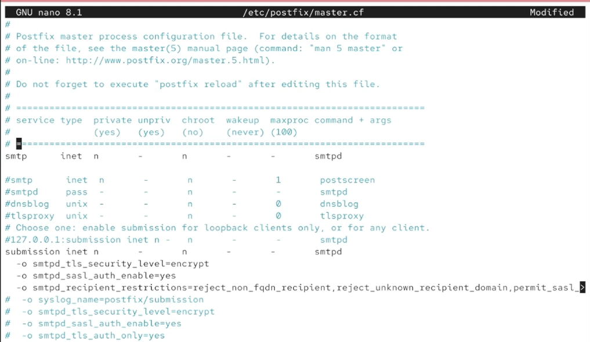{#fig:021}

Настраиваем firewall — разрешаем smtp-submission — и перезапускаем postfix (рис. [-@fig:022]).

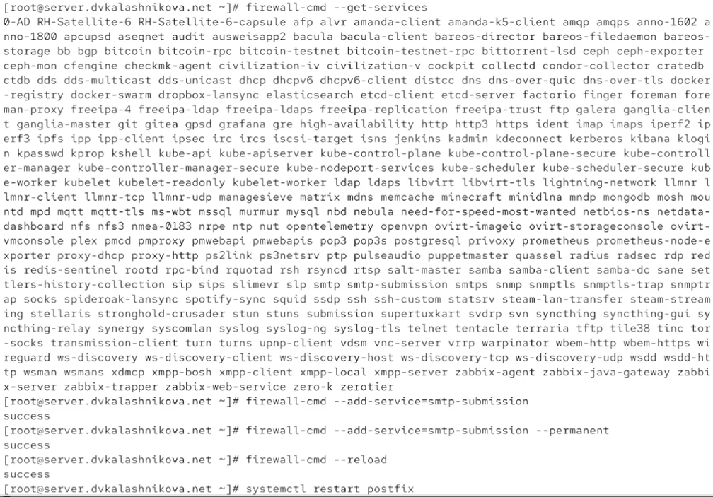{#fig:022}

Подключаемся к серверу через openssl (рис. [-@fig:023]).

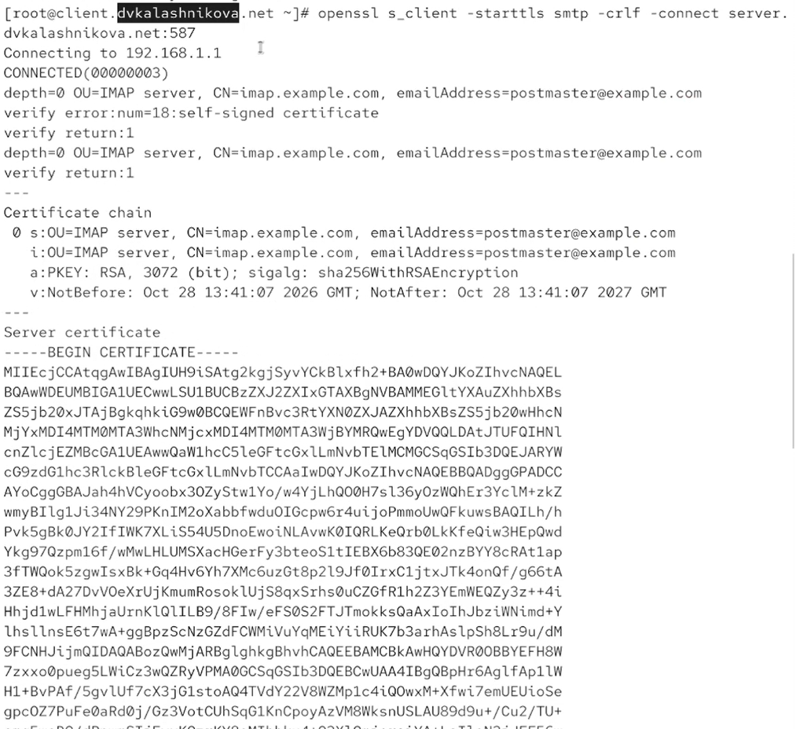{#fig:023}

Пробуем авторизоваться — всё проходит успешно (рис. [-@fig:024]).

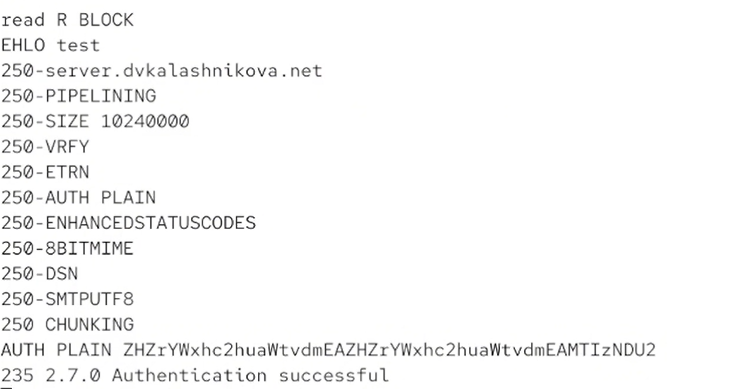{#fig:024}

В почтовом клиенте меняем порт smtp на 587, включаем авторизацию и шифрование (рис. [-@fig:025]).

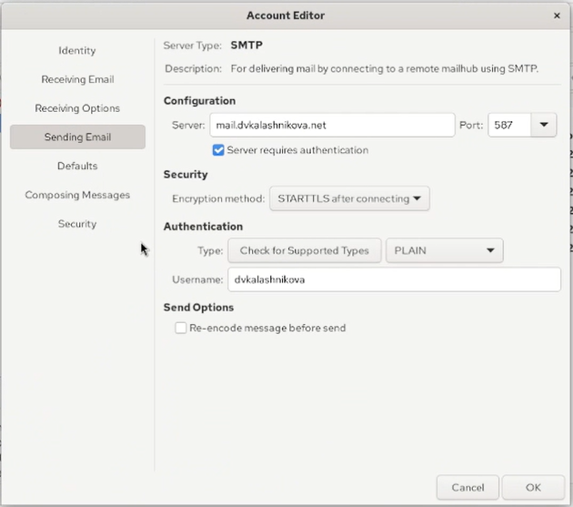{#fig:025}

Отправляем себе тестовое письмо (рис. [-@fig:026]).

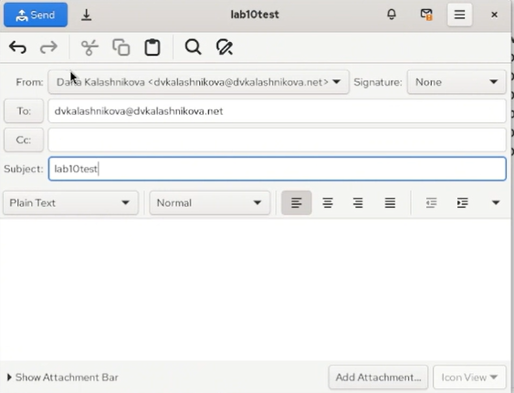{#fig:026}

Убеждаемся, что оно доставлено и лежит в ящике (рис. [-@fig:027]).

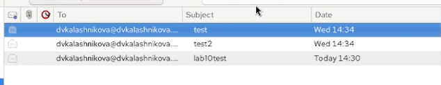{#fig:027}

По логам на сервере проверяем, что письмо действительно получено (рис. [-@fig:028]).

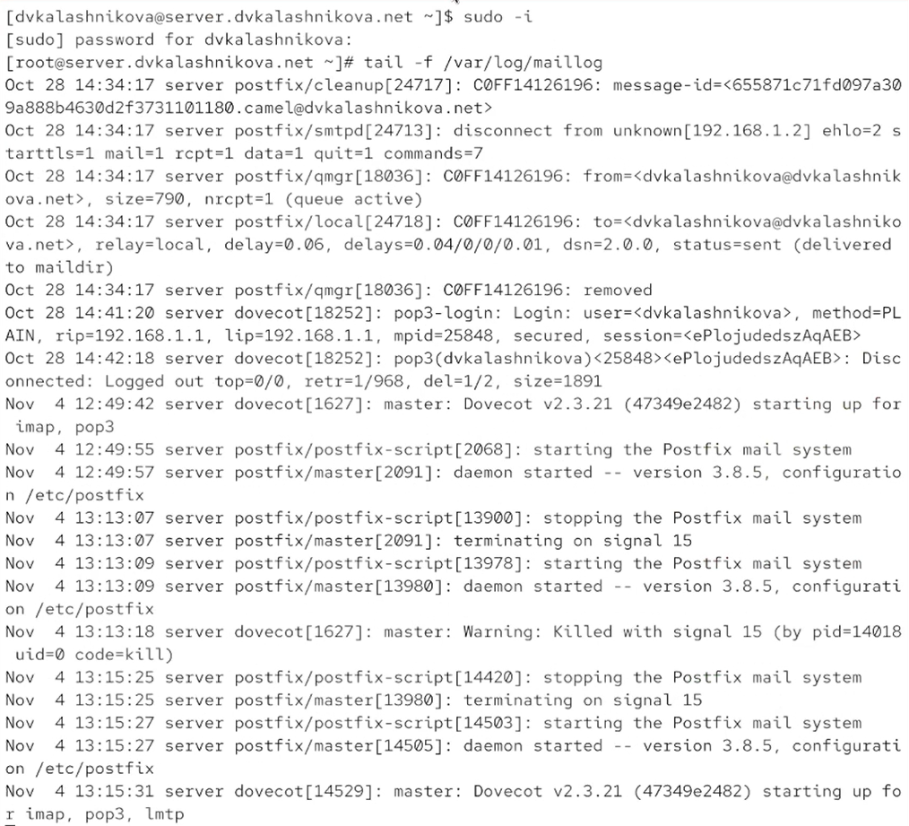{#fig:028}

Сохраняем внесённые изменения в vagrant (рис. [-@fig:029]).

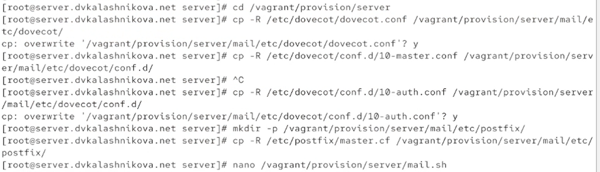{#fig:029}

На сервере изменяем скрипт mail.sh следующим образом (рис. [-@fig:030]).

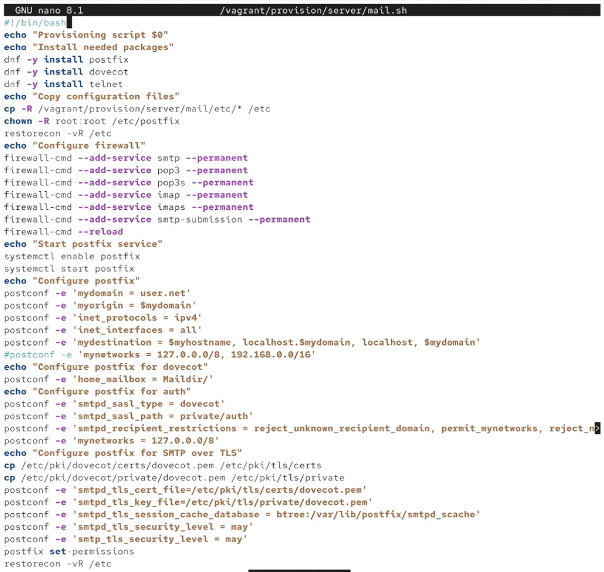{#fig:030}

# Выводы

В результате работы освоены приёмы продвинутой настройки SMTP и аутентификации.

# Список литературы {.unnumbered}

1. Postfix Project. Postfix Documentation [Электронный ресурс]. — URL: https://www.postfix.org/documentation.html (дата обращения: 06.11.2026).

2. Dovecot Project. Dovecot Documentation [Электронный ресурс]. — URL: https://doc.dovecot.org/ (дата обращения: 06.11.2026).

3. IETF. RFC 4954: SMTP Service Extension for Authentication [Электронный ресурс]. — URL: https://datatracker.ietf.org/doc/html/rfc4954 (дата обращения: 06.11.2026).
