## Докладчик

:::::::::::::: {.columns align=center}
::: {.column width="70%"}
  * Калашникова Дарья Викторовна
  * Студент
  * Российский университет дружбы народов
  * [1132243108@pfur.ru]
:::
::: {.column width="30%"}

:::
::::::::::::::

## Цель работы

Освоить методы управления системным временем и настройки его синхронизации через NTP.

## Проверка текущего времени на сервере

Утилита `timedatectl` показывает: часовой пояс UTC, системные часы синхронизированы, служба NTP активна.

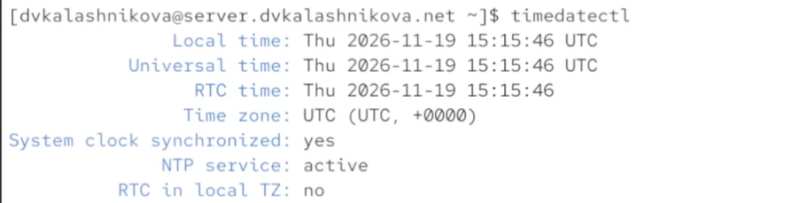{width=60%}

## Детальные свойства времени

Опция `show` выводит подробный список свойств временной конфигурации.

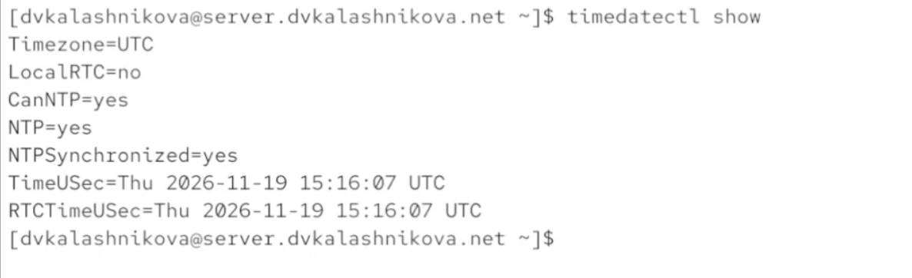{width=60%}

## Проверка времени на клиенте

Клиент тоже находится в UTC, синхронизация времени включена.

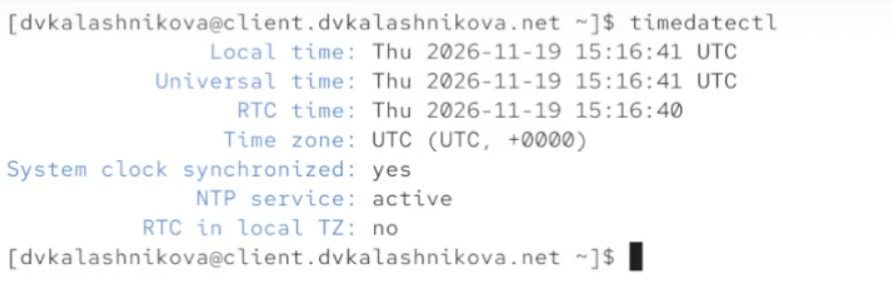{width=60%}

## Системное время на сервере

Команда `date` показывает текущее время. С флагом `-R` — вывод в формате RFC 2822.

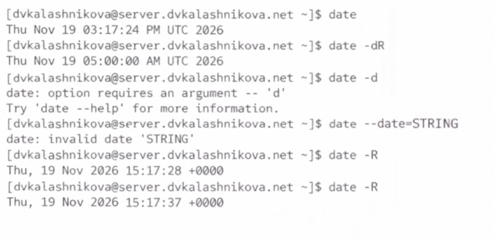{width=60%}

## Системное время на клиенте

Проверяем, что клиентское время совпадает с серверным.

{width=60%}

## Аппаратное время (RTC) на сервере

Утилита `hwclock` показывает время, которое хранится в аппаратных часах материнской платы.

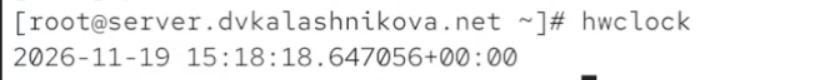{width=60%}

## Аппаратное время (RTC) на клиенте

Аналогичная проверка на клиенте.

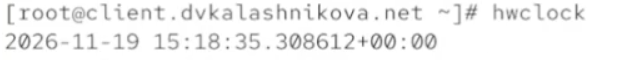{width=60%}

## Источники точного времени на сервере

`chronyc sources` показывает список внешних серверов, с которыми синхронизируется сервер.

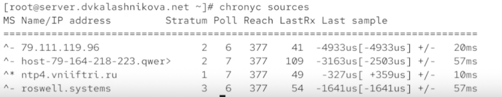{width=60%}

## Источники точного времени на клиенте (до настройки)

Сначала клиент тоже использует внешние пулы.

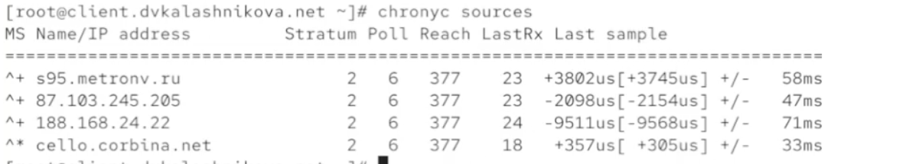{width=60%}

## Настройка NTP-сервера для локальной сети

В `/etc/chrony.conf` добавляем директиву `allow 192.168.0.0/16` — разрешаем клиентам из локальной сети запрашивать время.

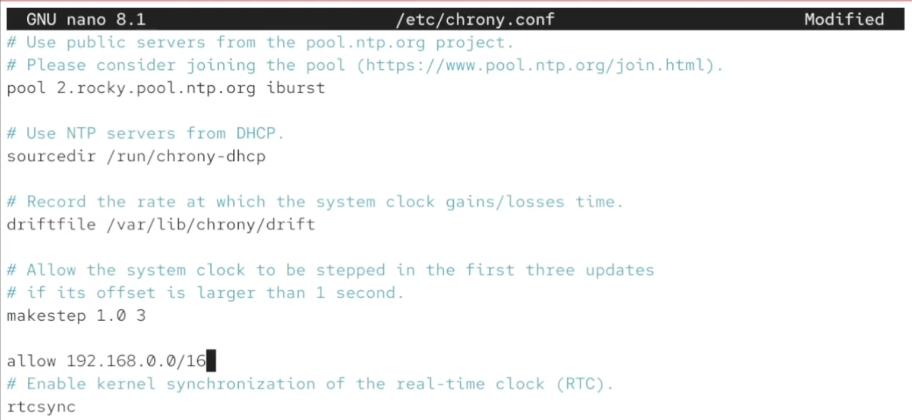{width=60%}

## Перезапуск службы и настройка Firewall

Применяем изменения и открываем доступ для NTP-трафика.

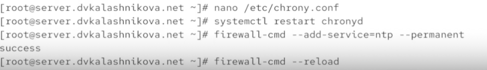{width=60%}

## Настройка клиента на локальный NTP-сервер

В `/etc/chrony.conf` на клиенте указываем сервер `server.dvkalashnikova.net` с параметром `iburst`.

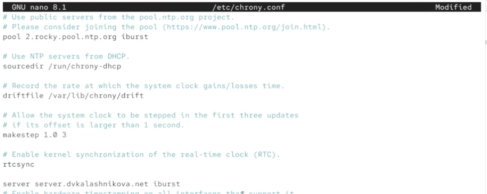{width=60%}

## Перезапуск chronyd на клиенте

Применяем настройки.

{width=60%}

## Проверка источников на сервере

Сервер синхронизируется с внешними эталонными серверами.

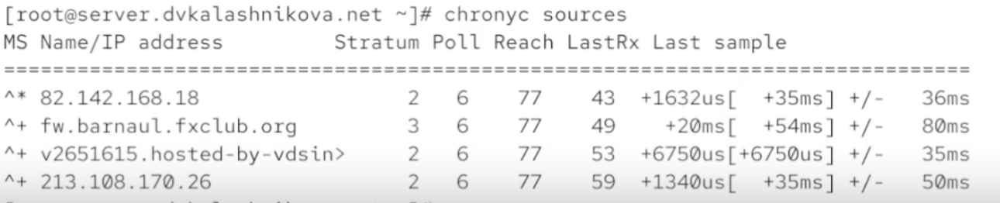{width=60%}

## Проверка источников на клиенте

В выводе `chronyc sources` видно, что `server.dvkalashnikova.net` (символ `+`) распознан как кандидат на синхронизацию, Stratum 3.

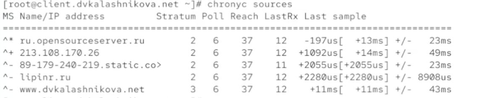{width=60%}

## Детальная информация о синхронизации

`chronyc tracking` показывает Reference ID, стратум, частоту и задержки.

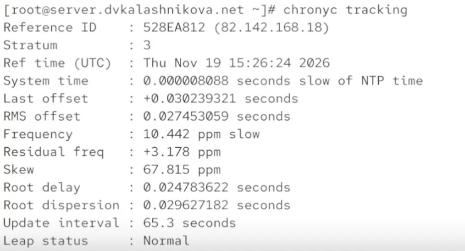{width=60%}

## Сохранение настроек в Vagrant

Создаём скрипт `ntp.sh` для автоматизации.

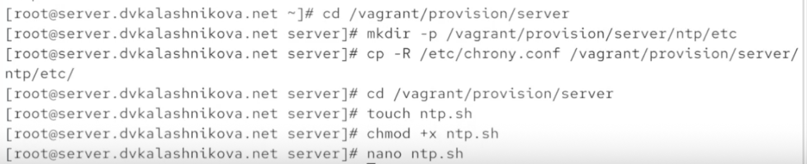{width=60%}

## Скрипт ntp.sh для сервера

В скрипте прописаны команды настройки NTP и Firewall.

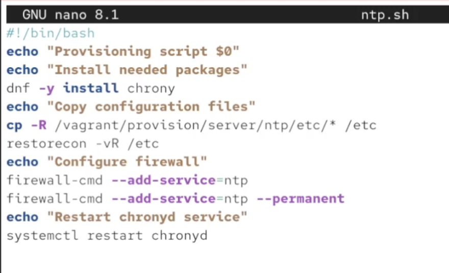{width=60%}

## Скрипт ntp.sh для клиента

Аналогичные действия на клиентской машине.

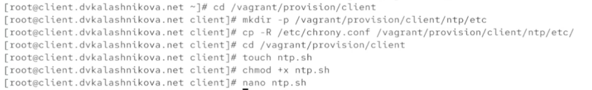{width=60%}

## Содержимое клиентского скрипта

Настройка chrony на клиенте: указание локального сервера времени.

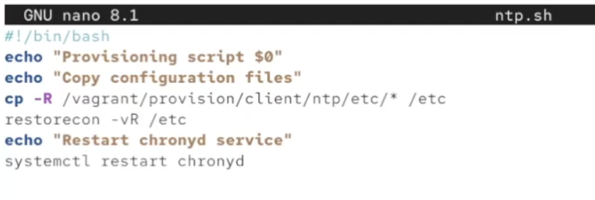{width=60%}

## Vagrantfile

Добавляем вызов скриптов в конфигурацию Vagrant.

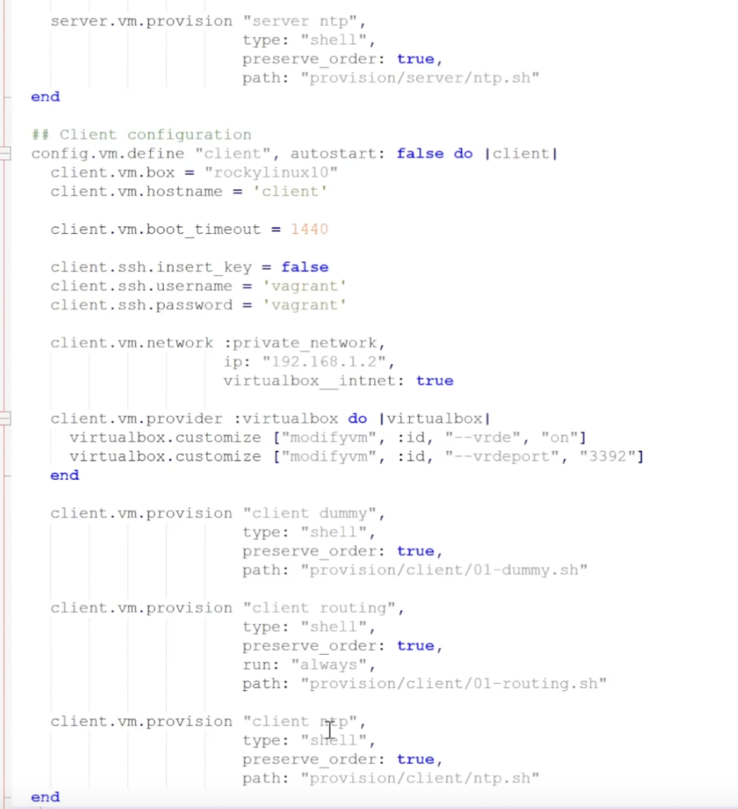{width=60%}

## Выводы

Получены навыки настройки системного времени и NTP-синхронизации на сервере и клиенте.

## Источники

1. chrony Project. chrony Documentation [Электронный ресурс]. — URL: https://chrony-project.org/documentation.html (дата обращения: 20.11.2026).
2. Red Hat. Configuring time synchronization with chrony [Электронный ресурс]. — URL: https://docs.redhat.com (дата обращения: 20.11.2026).
3. Oracle Linux. Managing System Time and NTP [Электронный ресурс]. — URL: https://docs.oracle.com (дата обращения: 20.11.2026).
4. Linux man-pages. timedatectl(1) [Электронный ресурс]. — URL: https://man7.org/linux/man-pages/man1/timedatectl.1.html (дата обращения: 20.11.2026).
5. Linux man-pages. chrony.conf(5), chronyc(1) [Электронный ресурс]. — URL: https://man7.org/linux/man-pages/man5/chrony.conf.5.html (дата обращения: 20.11.2026).
