# Цель работы

Освоить методы управления системным временем и настройки его синхронизации через NTP.

# Выполнение лабораторной работы

Первым делом на сервере изучим текущие параметры даты и времени с помощью утилиты `timedatectl`. Выяснилось, что система работает в часовом поясе UTC, системные часы синхронизированы, а служба NTP находится в активном состоянии (рис. [-@fig:001]).

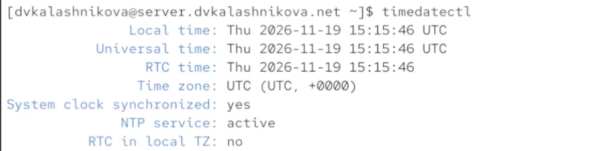{#fig:001}

Затем проведём несколько опытов с параметрами `timedatectl`. В частности, применим опцию `show`, чтобы вывести детальный список свойств временной конфигурации (рис. [-@fig:002]).

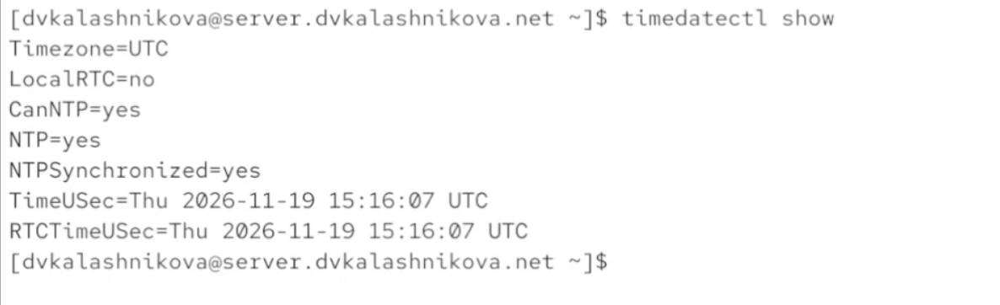{#fig:002}

Аналогичную проверку временных параметров выполним на клиентском узле. Клиент тоже находится в UTC, и сетевая синхронизация времени включена (рис. [-@fig:003]).

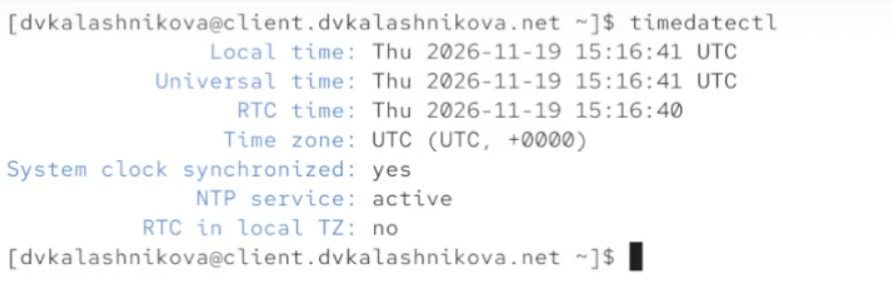{#fig:003}

На сервере посмотрим текущее системное время командой `date`. Поэкспериментируем с ключами: например, выведем дату в формате RFC 2822 с помощью флага `-R` (рис. [-@fig:004]).

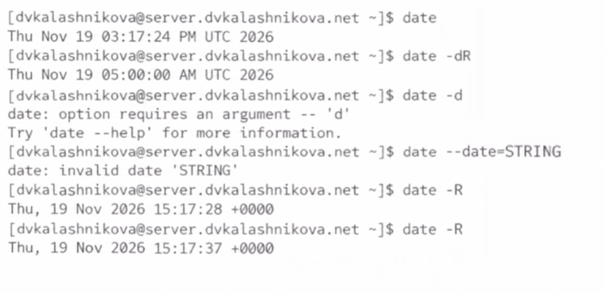{#fig:004}

На клиенте также посмотрим системное время (рис. [-@fig:005]).

{#fig:005}

Далее на сервере проверим аппаратное время (RTC) с помощью утилиты `hwclock` (рис. [-@fig:006]).

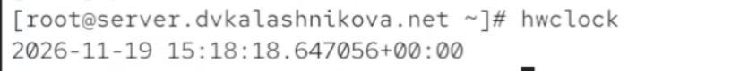{#fig:006}

Похожим образом посмотрим аппаратное время и на клиенте (рис. [-@fig:007]).

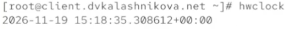{#fig:007}

Проверим источники точного времени на сервере через `chronyc sources`. Видно, что сервер синхронизируется с внешними серверами (рис. [-@fig:008]).

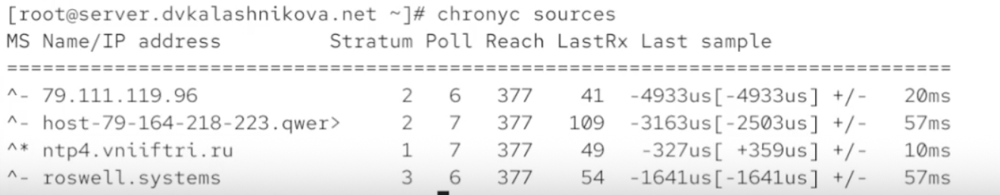{#fig:008}

Проверим источники точного времени и на клиенте. На этом этапе клиент тоже использует внешние пулы для синхронизации (рис. [-@fig:009]).

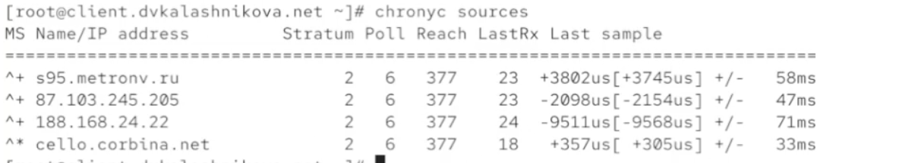{#fig:009}

Отредактируем конфигурационный файл `/etc/chrony.conf` на сервере. Добавим директиву `allow 192.168.0.0/16`, которая разрешает клиентам из локальной сети запрашивать точное время (рис. [-@fig:010]).

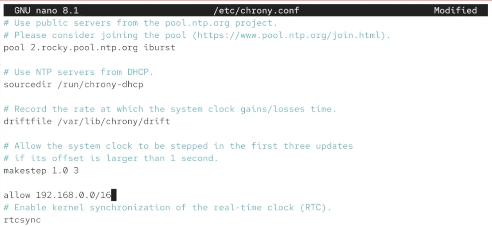{#fig:010}

Перезапустим службу синхронизации `chronyd`, чтобы применить изменения, и добавим службу NTP в исключения фаервола на сервере для входящих подключений (рис. [-@fig:011]).

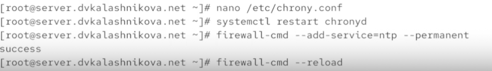{#fig:011}

Отредактируем `/etc/chrony.conf` на клиенте. Укажем локальный сервер `server.dvkalashnikova.net` в качестве источника времени с параметром `iburst` для ускоренной первичной синхронизации (рис. [-@fig:012]).

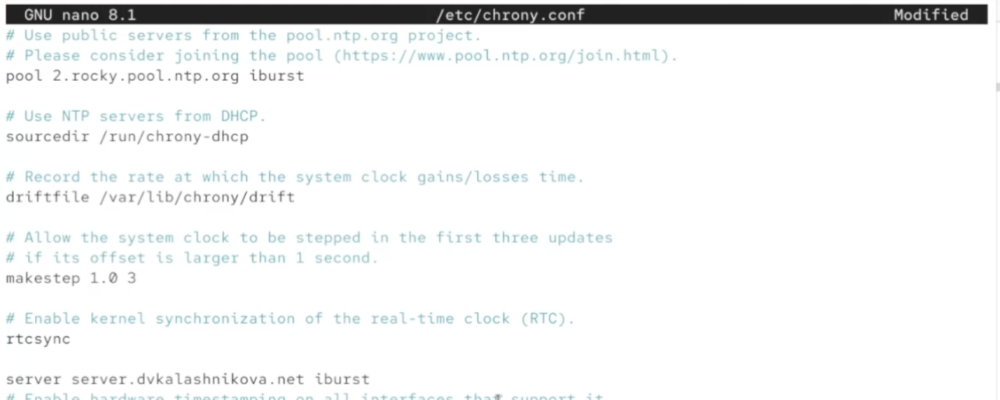{#fig:012}

Перезапустим службу `chronyd` на клиенте, чтобы настройки вступили в силу (рис. [-@fig:013]).

{#fig:013}

Снова посмотрим источники синхронизации на сервере. Вывод подтверждает наличие активных соединений с внешними эталонными серверами (рис. [-@fig:014]).

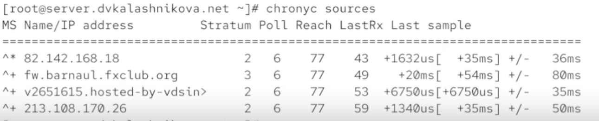{#fig:014}

Затем проверим источники времени на клиенте после изменения конфигурации. Команда `chronyc sources` показывает список серверов. В выводе видно, что настроенный нами `server.dvkalashnikova.net` (помечен символом `+`) распознан как кандидат на синхронизацию, имеющий Stratum 3. Это подтверждает, что DNS настроен верно, а сервер доступен (рис. [-@fig:015]).

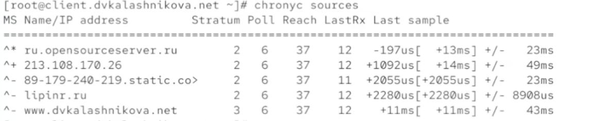{#fig:015}

Чтобы получить более подробную информацию о процессе синхронизации на сервере, применим команду `chronyc tracking`. Вывод содержит данные о Reference ID (вышестоящем сервере), текущем стратуме (Stratum 3), а также о частоте и задержках (рис. [-@fig:016]).

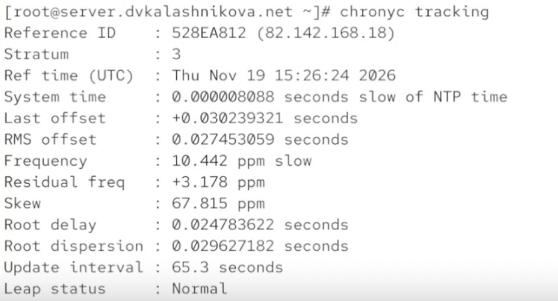{#fig:016}

Внесём изменения в Vagrant и создадим скрипт `ntp.sh` (рис. [-@fig:017]).

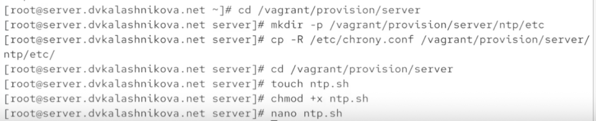{#fig:017}

Добавим следующие изменения в файл `ntp.sh` (рис. [-@fig:018]).

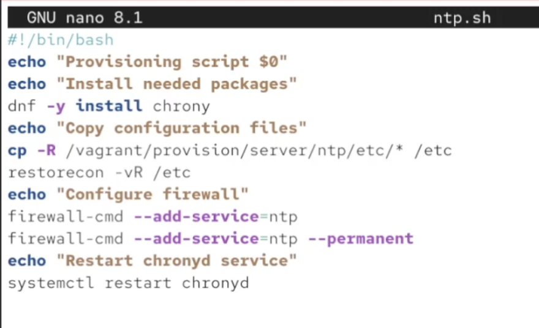{#fig:018}

Похожие действия по подготовке окружения выполним и на виртуальной машине client. Создадим исполняемый файл `ntp.sh` (рис. [-@fig:019]).

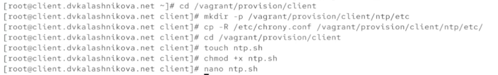{#fig:019}

Добавим следующие изменения в файл `ntp.sh` (рис. [-@fig:020]).

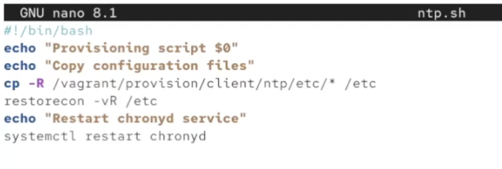{#fig:020}

Внесём изменения в `Vagrantfile` (рис. [-@fig:021]).

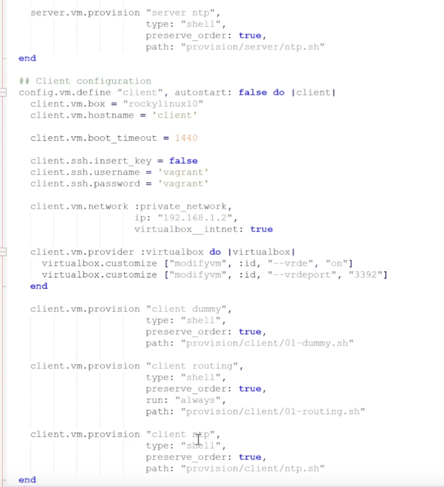{#fig:021}

# Выводы

В результате выполнения лабораторной работы были получены навыки настройки системного времени и синхронизации NTP.

# Список литературы {.unnumbered}

1. **Linux Kernel Archives.** autofs — how it works [Электронный ресурс]. — URL: https://docs.kernel.org/filesystems/autofs.html (дата обращения: 20.11.2026).
2. **Red Hat.** Mounting file systems on demand [Электронный ресурс]. — URL: https://docs.redhat.com (дата обращения: 20.11.2026).
3. **Oracle Linux.** Managing On-Demand Mounts Using autofs [Электронный ресурс]. — URL: https://docs.oracle.com (дата обращения: 20.11.2026).
4. **Red Hat.** Setting up a Kerberos-aware NFS Client [Электронный ресурс]. — URL: https://docs.redhat.com (дата обращения: 20.11.2026).
5. **Справочные страницы руководства:** autofs(5), automount(8) [Электронный ресурс]. — URL: https://man7.org/linux/man-pages/man5/autofs.5.html (дата обращения: 20.11.2026).
