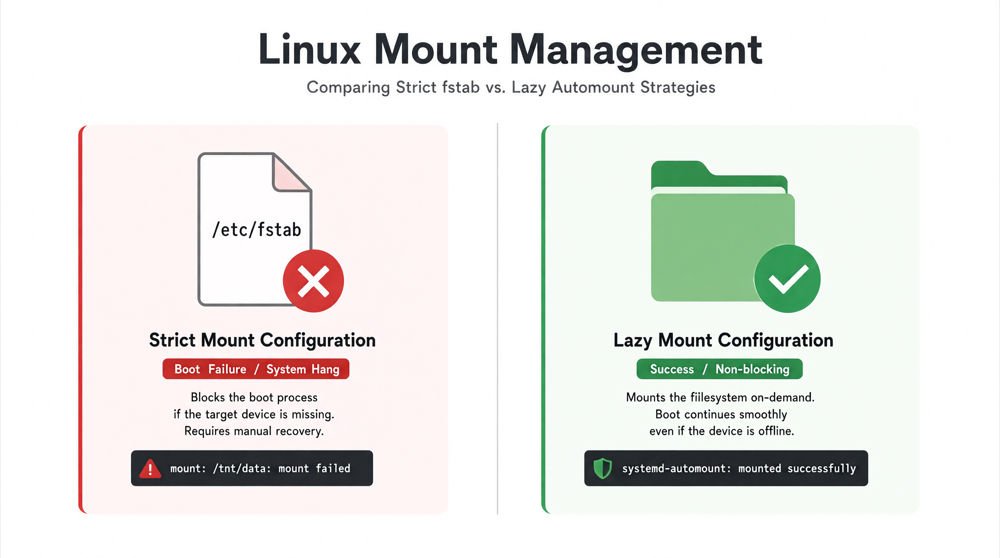
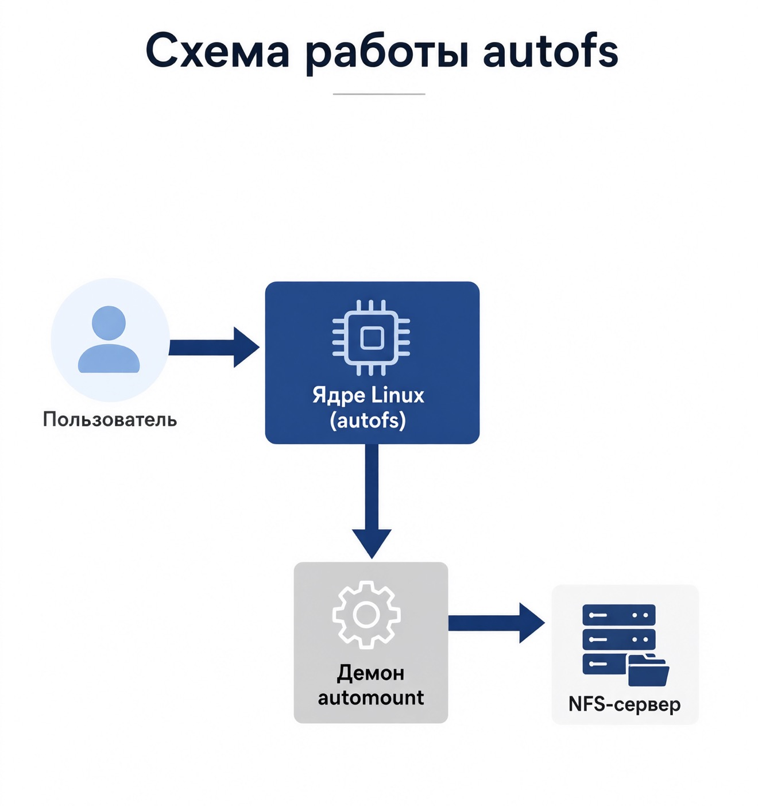
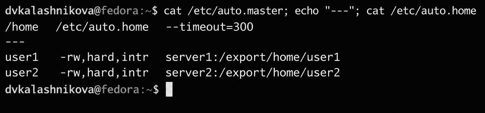
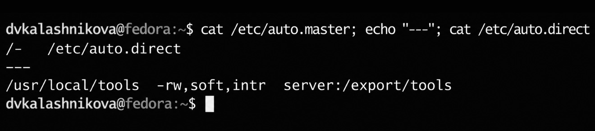

## Докладчик

:::::::::::::: {.columns align=center}
::: {.column width="70%"}
  * Калашникова Дарья Викторовна
  * Студент
  * Российский университет дружбы народов
  * [1132243108@pfur.ru]
:::
::: {.column width="30%"}

:::
::::::::::::::

## Цель доклада

Рассмотреть механизм автомонтирования NFS в Linux: его назначение, принцип работы, основные типы карт, способы настройки, интеграцию с Kerberos и NFSv4, а также преимущества и ограничения по сравнению со статическим монтированием через `/etc/fstab`.

## Что такое NFS

**NFS (Network File System)** — протокол удалённого доступа к файловым системам по сети. Клиент видит удалённый каталог как локальный.

Основные особенности:

- версии протокола: **NFSv3**, **NFSv4 / v4.1**;

- в NFSv4 появились состояние, блокировки, Kerberos, pNFS;

- NFS обычно работает совместно с **DNS** и **NTP** (синхронизация времени критична для Kerberos);

- автомонтирование избавляет от ручного подключения ресурсов после каждой перезагрузки.

## Проблема статического монтирования

При использовании `/etc/fstab` для NFS возникают серьёзные неудобства:

- **Блокировка загрузки.** Если NFS-сервер недоступен, команда `mount` ждёт тайм-аут, и система не загружается.

- **«Зависшие» процессы.** При обрыве сети обращения к каталогу уходят в непрерываемый сон.

- **Ручная настройка.** Каждая новая точка монтирования требует правки конфигурации на всех клиентах.

**Решение:** Autofs использует принцип ленивого монтирования.

## Проблема статического монтирования

{width=70%}

## Принцип работы autofs

`autofs` — это не скрипт в cron, а **файловая система ядра**, которая ставит «триггер» в точке монтирования. Когда процесс обращается к каталогу, VFS вызывает `lookup` или `revalidate`, ядро уведомляет демон `automount`, тот выполняет `mount` и возвращает статус. Размонтирование инициируется демоном с частотой **¼ от timeout** через `autofs expire ioctl`.

Пользователь не замечает разницы — каталог выглядит так, будто он смонтирован всегда. Если в течение 5 минут к каталогу не было обращений, autofs его размонтирует.

## Принцип работы autofs

{width=40%}

## Основные типы карт

Вся конфигурация autofs строится на картах:

- **Главная** (`auto.master`) — связывает точку монтирования с файлом карты и задаёт опции.

- **Косвенная** (indirect) — задаёт подкаталоги внутри родительского каталога. Применяется «на лету».

- **Прямая** (direct) — указывает полный путь для каждого ресурса. Требует `systemctl reload autofs`.

- **Специальная** (`-hosts`) — автоматически создаёт точки для всех экспортов NFS-сервера в `/net`.

## Пример настройки: косвенная карта

Косвенная карта используется, когда нужно смонтировать несколько каталогов внутри одного родительского.

{width=90%}

При обращении к `/home/user1` autofs автоматически смонтирует удалённый каталог. После 300 секунд неактивности монтирование будет снято.

## Пример настройки: прямая карта

Прямая карта применяется, когда точки монтирования находятся в разных местах файловой системы.

{width=90%}

Здесь точка монтирования `/usr/local/tools` будет создана непосредственно в указанном месте файловой системы.

## Проблема hard / soft

Опция по умолчанию — **`hard`**: при недоступности сервера процессы блокируются до восстановления связи. Это правильный выбор для read-write ресурсов — запись продолжится, данные не потеряются.

**`soft`** возвращает ошибку после исчерпания попыток. Документация ядра предупреждает о возможном **silent data corruption** при использовании `soft` на записываемых ресурсах.

**Практическое правило:**
- `hard` — для RW и данных, где важна целостность;
- `soft` — только для read-only и некритичных ресурсов;
- `intr` — устаревшая опция; современные ядра прерывают `hard`-ожидание сигналами без неё.

**Где задавать:** в `fstab` (поле опций) и в карте `autofs` (вторая колонка) — синтаксис идентичен.

## Интеграция с NFSv4 и Kerberos

NFSv4 использует аутентификацию на основе пользователя, а не UID/GID. Для безопасной работы применяется **Kerberos**:

- `sec=krb5` — только аутентификация;

- `sec=krb5i` — аутентификация и целостность;

- `sec=krb5p` — аутентификация, целостность и шифрование.

Параметр `Domain` в `/etc/idmapd.conf` должен совпадать на клиенте и сервере, иначе пользователь может получить отказ в доступе к файлам, даже если аутентификация прошла успешно.

**Важно:** `sec=` указывается и в карте `autofs`, синтаксис тот же, что в `fstab`:
`data  -rw,sec=krb5p  nfsserver:/export/data`

## Администрирование и типичные ошибки

**Управление службой:** `systemctl start|stop|restart|reload|status autofs`. Глобальный тайм-аут задаётся командой `automount -t <секунды>`.

**Распространённые ошибки:**
1. Использование опции `soft` (в карте autofs или `fstab`) на RW-ресурсах: при недоступном сервере монтирование «тихо» провалится, а на записываемых данных возможна порча — применяйте `soft` только для read-only.

2. Отсутствие `-fstype=nfs` в карте (autofs не распознает тип файловой системы).

3. Неверные права на файл карты (демон не может его прочитать).

4. Изменение прямой карты без `systemctl reload autofs` (изменения не вступят в силу).

## Выводы

Autofs обеспечивает ленивое монтирование NFS-ресурсов: файловая система подключается только при обращении и автоматически отключается после простоя. Это устраняет блокировку загрузки, снижает риск «зависших» монтирований и централизует управление через карты.

При построении защищённых систем autofs сочетается с **NFSv4 и Kerberos**, а корректная настройка `idmapd` и выбор опций `sec=` являются обязательными условиями безопасной эксплуатации.

## Источники

1. **Linux Kernel Archives.** autofs — how it works. — URL: docs.kernel.org/filesystems/autofs.html (дата обращения: 19.10.2026).
2. **Red Hat.** Mounting file systems on demand. — URL: docs.redhat.com (дата обращения: 19.10.2026).
3. **Oracle Linux.** Managing On-Demand Mounts Using autofs. — URL: docs.oracle.com (дата обращения: 19.10.2026).
4. **Red Hat.** Setting up a Kerberos-aware NFS Client. — URL: docs.redhat.com (дата обращения: 19.10.2026).
5. **Linux man pages.** `autofs(5)`, `automount(8)` (дата обращения: 19.10.2026).
