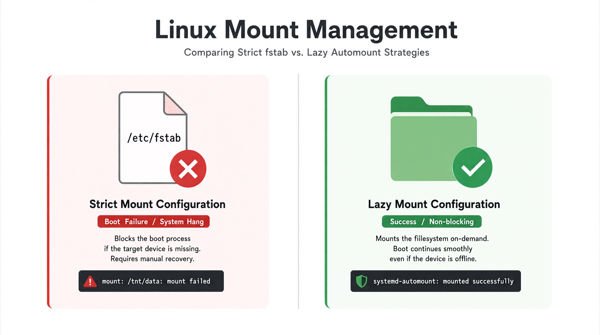
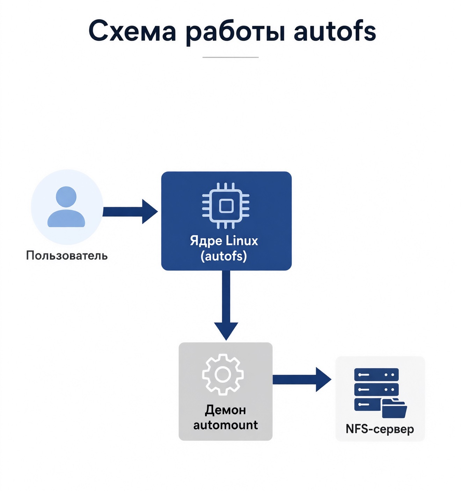
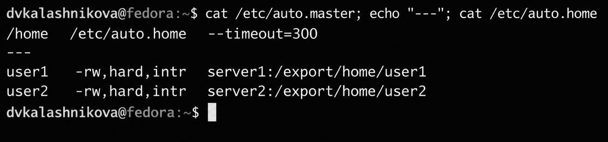
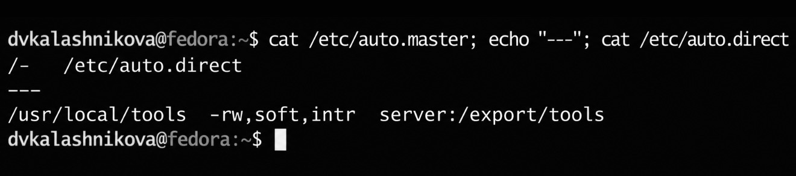

# Введение

Сетевые файловые системы (Network File System, NFS) давно стали стандартом де-факто для организации централизованного хранения данных в корпоративных и университетских IT-инфраструктурах. С их помощью сотрудники и студенты получают доступ к единым файловым ресурсам с различных рабочих мест, а системные администраторы могут управлять правами доступа и резервным копированием из единого центра. В крупных организациях NFS часто используется для хранения домашних каталогов пользователей, общих библиотек, образов виртуальных машин и резервных копий баз данных.

Однако использование NFS сопряжено с рядом административных сложностей. Традиционный подход, предполагающий статическое монтирование через файл `/etc/fstab`, имеет существенный недостаток: если сетевой сервер недоступен в момент загрузки клиентской машины, операционная система может зависнуть на этапе инициализации или перейти в аварийный режим. На практике это выглядит так: сотрудник включает компьютер утром, но из-за того, что файловый сервер ещё не загрузился или временно недоступен из-за сетевой аварии, система «висит» на экране загрузки несколько минут, а иногда и вовсе требует ручного вмешательства администратора.

Кроме того, постоянное поддержание соединения для редко используемых ресурсов нерационально расходует сетевые ресурсы. Например, если отдел пользуется общим архивом раз в неделю, держать его смонтированным 24/7 на всех 50 машинах отдела — это лишняя нагрузка на сервер и на сеть.

**Актуальность** темы обусловлена необходимостью повышения отказоустойчивости Linux-систем и снижения нагрузки на администраторов. Решением является **автомонтирование** — технология, позволяющая подключать файловую систему «по требованию», в момент первого обращения к каталогу, и автоматически размонтировать её после простоя [1].

Исторически механизм `autofs` появился ещё в конце 1990-х годов как часть проекта Linux kernel. Изначально он создавался для поддержки автоматического монтирования домашних каталогов пользователей в университетских сетях, где количество пользователей исчислялось тысячами, а держать все каталоги смонтированными было невозможно. Сегодня `autofs` — это стандартный компонент большинства дистрибутивов Linux, включая Red Hat Enterprise Linux, Oracle Linux, Ubuntu и Debian.

**Цель работы** — рассмотреть механизм автомонтирования NFS в Linux, его назначение, принцип работы, основные типы карт, способы настройки, интеграцию с Kerberos и NFSv4, а также преимущества и ограничения по сравнению со статическим монтированием.

**Задачи:**

1. Изучить проблему статического монтирования NFS.

2. Рассмотреть архитектуру и принцип работы демона `autofs`.

3. Описать основные типы карт и привести примеры их настройки.

4. Проанализировать вопросы безопасности при интеграции с Kerberos.

5. Выявить типичные ошибки администраторов.

# Проблема статического монтирования NFS

NFS — это протокол, позволяющий клиенту видеть удалённый каталог как локальный [2]. В настоящее время распространены версии NFSv3 и NFSv4 (включая v4.1), причём NFSv4 привносит встроенные механизмы блокировок, состояния и поддержку Kerberos. Для работы NFS обычно требуется инфраструктура **DNS** (для разрешения имён) и **NTP** (синхронизация времени критична для Kerberos) [3].

При использовании `/etc/fstab` администратор прописывает правило монтирования, которое применяется при загрузке. Это порождает три серьёзные проблемы:

- **Блокировка загрузки.** Если NFS-сервер недоступен, команда `mount` ждёт истечения тайм-аута, и система не загружается [2]. На практике это может привести к тому, что сервер баз данных, размещённый на той же машине, не запустится вовремя, и бизнес-процессы остановятся.
- **«Зависшие» процессы.** При обрыве сети обращения к каталогу уходят в непрерываемый сон (uninterruptible sleep), что может привести к сбою приложений [1]. Например, если веб-сервер обращается к статическим файлам на NFS, при обрыве связи он может «зависнуть» и перестать отвечать на запросы пользователей.
- **Ручная настройка.** Каждая новая точка монтирования требует правки конфигурации на всех клиентах. В крупной организации с сотнями машин это превращается в рутинную и подверженную ошибкам операцию.

Решением является технология **ленивого (on-demand) монтирования**, реализуемая демоном `autofs` [1]. Она позволяет избежать всех трёх проблем, сохраняя при этом прозрачность для пользователей.

{width=85%}

# Принцип работы autofs

В отличие от скриптов, запускаемых по расписанию (cron), `autofs` является **файловой системой ядра**. В точке монтирования создаётся «триггер». Когда пользователь или процесс обращается к каталогу, виртуальная файловая система (VFS) вызывает функции `lookup` или `revalidate`. Ядро уведомляет демон `automount`, который выполняет фактическое монтирование ресурса и возвращает статус [1].

Если в течение заданного тайм-аута (по умолчанию 5 минут) к каталогу не было обращений, демон инициирует размонтирование через `autofs expire ioctl` [1]. С точки зрения пользователя, каталог выглядит так, будто он смонтирован всегда — разница незаметна [2].

Стоит отметить, что в современных системах, использующих systemd, существует также механизм `systemd.automount`, который решает похожую задачу, но работает на уровне менеджера служб, а не ядра. Однако `autofs` остаётся более гибким инструментом для работы с NFS, особенно в сложных конфигурациях с множеством карт и опций безопасности.

{width=70%}

# Основные типы карт

Вся конфигурация `autofs` строится на картах — текстовых файлах, описывающих правила монтирования [5].

1. **Главная карта** (`auto.master`) связывает точку монтирования с файлом карты и задаёт глобальные опции (например, `timeout`) [5].
2. **Косвенная карта (indirect)** задаёт подкаталоги внутри родительского каталога. Например, правило для `/home/user1` активируется «на лету» при обращении. Изменения в ней применяются без перезапуска службы [3].
3. **Прямая карта (direct)** указывает полный путь для каждого ресурса (например, `/usr/local/tools`). Она требует перезагрузки конфигурации командой `systemctl reload autofs` [3].
4. **Специальная карта** (`-hosts`) автоматически создаёт точки монтирования для всех экспортов NFS-сервера в каталоге `/net` [5].

## Пример настройки: косвенная карта

Косвенная карта используется для монтирования домашних каталогов пользователей. В файле `auto.home` прописывается правило, при обращении к `/home/user1` autofs автоматически смонтирует удалённый каталог. После 300 секунд неактивности монтирование будет снято [2]. Это особенно удобно в университетских лабораториях, где студенты работают под своими учётными записями на разных машинах.

{width=90%}

## Пример настройки: прямая карта

Прямая карта применяется, когда точки монтирования находятся в разных местах файловой системы. Она позволяет создать точку `/usr/local/tools` непосредственно в указанном месте [3]. Например, для общих инструментов разработки, которые используются разными отделами и должны быть доступны по фиксированному пути.

{width=90%}

# Проблема выбора опций hard и soft

Критически важным при настройке NFS является выбор поведения при недоступности сервера [1]:

- **`hard` (по умолчанию):** процессы блокируются до восстановления связи. Для read-write ресурсов это правильный выбор: запись продолжится после восстановления, данные не потеряются [1].
- **`soft`:** после исчерпания попыток возвращается ошибка. Документация ядра предупреждает о возможном **silent data corruption** (тихой порче данных) при использовании `soft` на записываемых ресурсах [1].

**Практическое правило:** `hard` — для RW и любых данных, где важна целостность; `soft` — только для read-only и некритичных ресурсов. Опция `intr` считается устаревшей, современные ядра прерывают `hard`-ожидание сигналами без неё [1]. Синтаксис задания этих опций в `fstab` и в картах `autofs` идентичен [5].

# Интеграция с NFSv4 и Kerberos

NFSv4 использует аутентификацию на основе пользователя, а не UID/GID. Для безопасной работы применяется **Kerberos**, поддерживающий три режима [4]:

- `sec=krb5` — только аутентификация;
- `sec=krb5i` — аутентификация и целостность;
- `sec=krb5p` — аутентификация, целостность и шифрование.

Параметр `Domain` в файле `/etc/idmapd.conf` должен совпадать на клиенте и сервере. В противном случае пользователь может получить отказ в доступе к файлам, даже если аутентификация прошла успешно [4]. Синтаксис `sec=` в картах `autofs` совпадает с синтаксисом в `/etc/fstab` [4].

При выборе режима безопасности стоит учитывать, что `sec=krb5p` (с шифрованием) создаёт дополнительную нагрузку на процессор и сеть. В локальных сетях с низким риском перехвата трафика иногда достаточно `sec=krb5i`, а для критичных данных, передаваемых через публичные каналы, рекомендуется `sec=krb5p`.

# Администрирование и типичные ошибки

Управление службой осуществляется через `systemctl start|stop|restart|reload|status autofs`. Глобальный тайм-аут задаётся командой `automount -t <секунды>` [5].

**Распространённые ошибки:**

1. Использование опции `soft` на RW-ресурсах: при недоступном сервере монтирование «тихо» провалится, а на записываемых данных возможна порча [1].
2. Отсутствие `-fstype=nfs` в карте — autofs не распознает тип файловой системы [3].
3. Неверные права на файл карты — демон не может его прочитать [5].
4. Изменение прямой карты без выполнения `systemctl reload autofs` — изменения не вступят в силу [3].

Для диагностики проблем с autofs можно использовать команду `automount -d` (отладочный режим) и проверять системные логи через `journalctl -u autofs`. Это помогает быстро выявить ошибки в картах и проблемы с доступностью NFS-серверов.

# Заключение

В ходе работы был рассмотрен механизм автомонтирования NFS в Linux. Установлено, что `autofs` обеспечивает ленивое монтирование: файловая система подключается только при обращении и автоматически отключается после простоя [1]. Это устраняет блокировку загрузки, снижает риск «зависших» монтирований и централизует управление через карты [2].

При построении защищённых систем `autofs` сочетается с NFSv4 и Kerberos [4]. Корректная настройка `idmapd` и выбор опций `sec=` являются обязательными условиями безопасной эксплуатации [4]. Выбор между `hard` и `soft` должен основываться на типе данных: для критичных RW-ресурсов предпочтителен `hard`, чтобы избежать порчи данных [1].

Таким образом, использование `autofs` является современным и надёжным подходом к организации сетевого хранилища в Linux-инфраструктуре. Он хорошо зарекомендовал себя как в небольших организациях, так и в крупных корпоративных средах, где важны отказоустойчивость и централизованное управление.

# Список литературы

1. Linux Kernel Archives. autofs — how it works [Электронный ресурс]. — URL: https://docs.kernel.org/filesystems/autofs.html (дата обращения: 19.10.2026).
2. Red Hat. Mounting file systems on demand [Электронный ресурс]. — URL: https://docs.redhat.com (дата обращения: 19.10.2026).
3. Oracle Linux. Managing On-Demand Mounts Using autofs [Электронный ресурс]. — URL: https://docs.oracle.com (дата обращения: 19.10.2026).
4. Red Hat. Setting up a Kerberos-aware NFS Client [Электронный ресурс]. — URL: https://docs.redhat.com (дата обращения: 19.10.2026).
5. Справочные страницы руководства: autofs(5), automount(8) [Электронный ресурс]. — URL: https://man7.org/linux/man-pages/man5/autofs.5.html (дата обращения: 19.10.2026).
